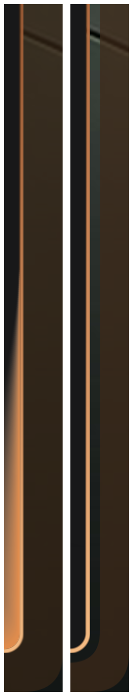
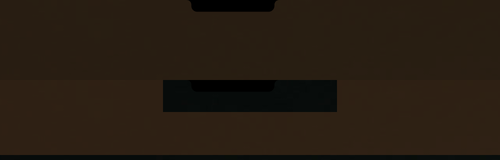
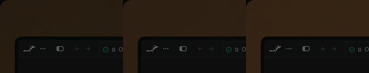
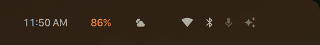

# Bar Stage 30: the hull is back, and only the hull is tinted (2026-11-26)

Built by Claude Sonnet 5.5 from `docs/omarchy-bar-refined-brief.md` and `docs/omarchy-bar-stage-30-brief.md`. `docs/reference/omarchy-shell-frame-diagram.html` (diagram v5, one unified rounded frame) was the visual source of truth. Both files were downloaded into the repo first and are committed with this report.

**Not touched:** depths (top 75 / left 30 / right 15 / bottom 15), radii (outer 20 / inner 16), reserves `[30, 75, 15, 15]`, element homes, the float default, Super+L, Super+T, the leader keys, and the launcher, emoji and clipboard pickers. No notch disguise, no black top, no pills, no new elements.

## Live audit before any change

What was on screen, measured in a full-screen `grim` capture (physical px, 2×):

| Spot | Pixel | What it is |
|---|---|---|
| Top band (x 600, y 100) | (40, 29, 18) | hull |
| Left band (30, 1100) | (41, 30, 19) | hull |
| Bottom band (1000, 2225) | (42, 32, 20) | hull |
| **Desktop gap between two windows (1940, 1500)** | **(41, 30, 17)** | **should be wallpaper, but was tinted like the hull** |
| **Notch area (1700, 30)** | **(40, 29, 18)** | **should be a hole, but was filled** |

In plain words: **the whole screen was tinted.** The hull, the desktop opening and the notch all had the same fill. With no difference between the frame and the desktop, there was no hull boundary, no opening and no notch hole. The Stage 29 report's "frame pixel (39, 28, 17)" was true, but the desktop was the same colour, and that report never sampled it.

**Cause in the code:** `jimmy.frame/Frame.qml` built the right path (outer rounded rect + inner rounded opening + notch rect) and then called `ctx.fill("evenodd")`. **QML's Canvas `Context2D.fill()` takes no fill-rule argument.** It silently ignores `"evenodd"` and uses `ctx.fillRule`, which defaults to `Qt.WindingFill`. All three subpaths wind the same way, so under the winding rule the opening and the notch were filled as solid, not cut out. The bug has been there **since Stage 28**. At Stage 28 the fill was dark `background` at 0.70, which over a dark wallpaper was close to invisible. Stage 29's accent tint made the full-screen fill obvious. The tint itself (`Qt.tint(background, accent)`) was fine; only its scope was wrong.

## The fix: scope first

```qml
ctx.fillRule = Qt.OddEvenFill
ctx.fillStyle = rgba(glass)
ctx.fill()
```

That is the whole change to `Frame.qml` (plus a two-line comment). The Stage 28/29 code was otherwise correct, so restoring from the Stage 28 backup was **not** needed. The opening and the notch are now real odd-even cut-outs, not tinted overlays. QML changes don't hot-reload, so this took one `omarchy restart shell`, on its own.

After:

| Spot | Before | After |
|---|---|---|
| Desktop gap (1940, 1500) | (41, 30, 17) tinted | **(9, 14, 7)**: raw wallpaper, untinted |
| Notch (1728, 40) | filled | **(7, 11, 10)**: a hole; the camera covers it |
| Hull top (600, 100) | (40, 29, 18) | (40, 29, 17) at 0.18 → **(46, 32, 19)** at 0.22 |

The hull now matches diagram v5: one piece with rounded outer corners (20), a rounded inner opening (16), and no line across the bottom of the top reserve. The edge stays off (`frame.edge = 0`, as in Stage 29); the fill boundary is the hull edge.



*Right edge, 2× zoom. Before: the tint runs right up to the window border and the wallpaper is gone. After: green-grey wallpaper shows between the window and the hull, with the rounded inner corner at the bottom and the cut outer corner below it.*



*Notch. Before: the top band is filled straight through it. After: a dark 174 × 32 hole through the top band, centred. The small black rounded shape is the existing notch plugin, not the frame.*

## Tint: the hull only, raised slightly

The fill is still `Qt.tint(Commons.Color.background, accent @ frame.tint)` at the launcher glass alpha. It is derived from the theme, with no literal orange. `frame.tint` hot-reloads from `shell.toml`, so I stepped it live and screenshotted each step:

| `frame.tint` | Hull pixel | Desktop pixel | Judgement |
|---|---|---|---|
| 0.18 (Stage 29) | (41, 30, 19) | (9, 14, 7) | Reads now that the opening is clear, but quiet |
| **0.22: shipped** | **(47, 33, 21)** | **(9, 14, 7)** | Warm accent glass, reads at a glance, not solid |
| 0.26 | (54, 37, 22) | (9, 14, 7) | Heading toward a solid brown bar |



The desktop pixel did not change at any step: the tint reaches the hull only.

## Top row: live ink centres in the 75px band

Measured from the live capture: each element's thresholded ink bounding box, in logical px. Battery measures the "86%" text only; the charge dot is excluded. The stay-awake cup is excluded because it disappears at build end. Target: **37.5**. The grid is 0.5 logical px, so an element with an odd physical ink height can only land at 37.25 or 37.75.

| Element | Before (live, after the hull fix) | After |
|---|---|---|
| Window title | 37.5 | **37.5** |
| Time | 37.75 (odd height) | **37.75** (odd height, at the grid limit) |
| Battery % | 37.75 (odd height) | **37.75** (odd height, at the grid limit) |
| Weather glyph | 37.75 (odd height) | **37.75** (odd height, at the grid limit) |
| Wi‑Fi | 37.75 (odd height) | **37.25** (odd height, at the grid limit) |
| Bluetooth | **38.0** | **37.5** |
| Mic | **38.0** | **37.5** |
| Agents | **38.0** | **37.5** |

Stage 29 reported the status glyphs at 37.5; live, Bluetooth, mic and agents were at 38.0, one physical pixel low. Fix: the shared `StatusLight` glyph offset in `Bar.qml` went from 0.75 to **0.25**, then one shell restart, on its own. Every element now sits within ±0.25 of 37.5.



## Left numbers and notch

- **Left numbers:** these sit directly on the 30px left band, with no pill. Ink x-centres are **14.75** ("1", active) and **15.25** ("3") against the band centre of 15. The active "1" renders in accent **#EE883C** on the hull **#2E2014**, so the stronger fill does not wash it out.
- **Notch:** a real 174 × 32 cut-out through the top band, centred. Against the corrected hull it reads as a dark gap in the warm band, which the camera covers. No disguise in this stage.

## Build checklist

| Step | Result |
|---|---|
| Build start | `omarchy-kbd-backlight hold` (saved level 0) and `omarchy toggle idle stay-awake` |
| Backup | **`~/.local/state/omarchy-launcher-backups/20261126-114817-bar-stage-30`**: mode 700, **2,403 files**, 872 MB, local only, taken before any edit. Same scope as Stage 29: every `~/.config/hypr` file, all of `~/.config/omarchy` (every plugin including all `jimmy.*`, themes, themed, hooks, backgrounds, `shell.json`, `shell.toml`, …), `~/.config/systemd`, `~/.config/vicinae/settings.json`, `~/.local/bin`, and the saved `~/.local/state/omarchy/toggles` and `workspace-layouts`. Checksums: live before = backup |
| Excluded (named) | `*.bak*` snapshots; `__pycache__` (two `.pyc` files that were in Stage 29's set); symlinks (`afterburn-watch`, `orca-ide`, `superwhisper` in `~/.local/bin`); all runtime state (clipboard history, images and pins, emoji pins and recents, the pause flag, notifications, agents, indicators, scratchpad). No runtime state in git |
| Live after | `sha256sum -c` against the backup: only the three intended files differ (`Frame.qml`, `Bar.qml`, `shell.toml`) |
| Reloads | Two `omarchy restart shell`, each on its own and only for a QML change (Frame, then Bar). `frame.tint` hot-reloaded. No `hyprctl reload` needed; never `refresh` |
| Health | `hyprctl configerrors` empty; no `jimmy.frame` / `jimmy.bar` QML errors; `console.log` = 0; theme still Afterburn; reserves `[30, 75, 15, 15]` |
| Build end | `omarchy toggle idle allow-idle`, `omarchy-kbd-backlight release` (level 0 restored, auto resumes) → `omarchy-shell idle status`: **`"enabled":true,"stayAwake":false`** |
| Snapshot | `plugins/jimmy.frame/Frame.qml`, `plugins/jimmy.bar/Bar.qml`, `config/omarchy/shell.toml` equal live |

## Files changed

- `~/.config/omarchy/plugins/jimmy.frame/Frame.qml`: `ctx.fillRule = Qt.OddEvenFill`; `fill()` with no argument.
- `~/.config/omarchy/plugins/jimmy.bar/Bar.qml`: `StatusLight` glyph offset 0.75 → 0.25.
- `~/.config/omarchy/shell.toml`: `[frame] tint = 0.22`; comment updated.
- Repo snapshots of the three files above; `docs/omarchy-bar-stage-30-brief.md`, `docs/reference/omarchy-shell-frame-diagram.html`, this report, and `docs/reports/bar-stage-30/*.png` (frame-only crops).

## Still open

- **Tint strength** is one token. 0.22 is shipped; 0.18 and 0.26 were both tried live. Judge it by eye against busier wallpapers.
- **Quick-strip icon offset** (`Bar.qml`, the stay-awake cup's `anchors.verticalCenterOffset: 0.75`) has no `verticalCenter` anchor, so it does nothing. I left it alone because it is out of scope, and the cup only shows while stay-awake is on.
- The theme-switch check was not re-run this stage. The fill expression is unchanged from Stage 29, which followed Afterburn ↔ Afterburn Lite, and only the fill rule changed.
