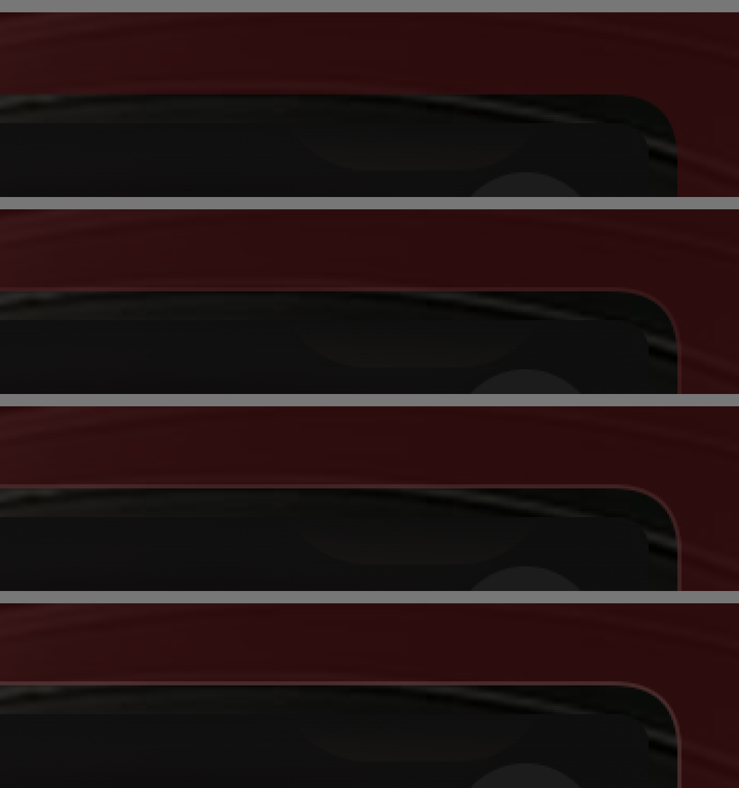
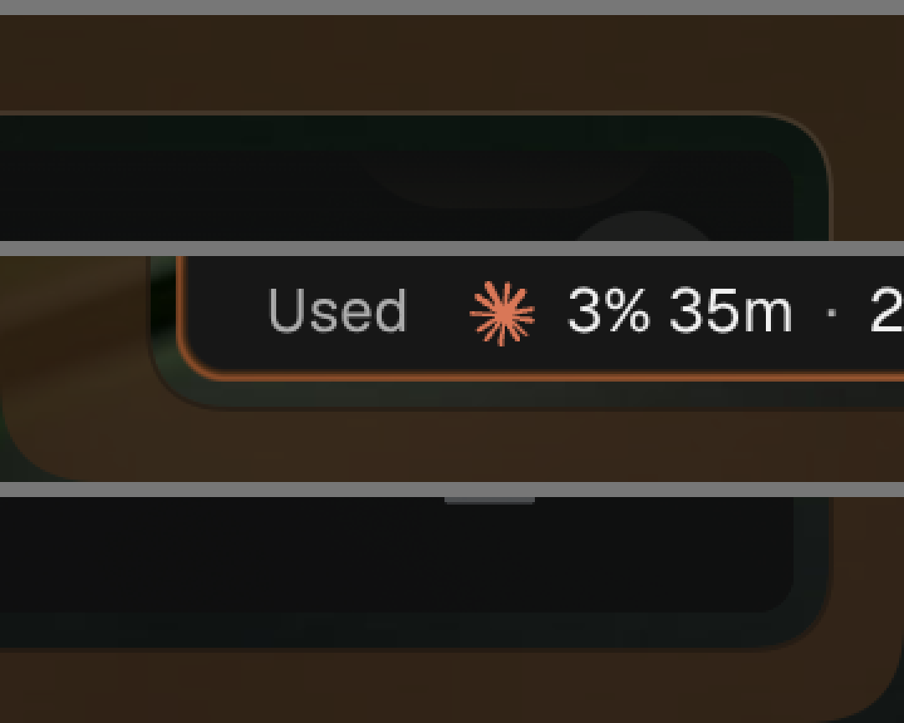
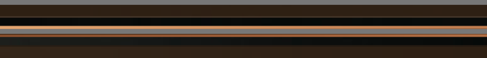

# Bar Stage 31: the slightest bevel on the opening edge (2026-11-26)

Built by Claude Sonnet 5.5 from `docs/omarchy-bar-refined-brief.md` and `docs/omarchy-bar-stage-31-brief.md`. `docs/reference/omarchy-shell-frame-diagram.html` (v5, one unified hull) was the frame reference. The brief was downloaded into `docs/` first and is committed with this report.

**Not touched:** `frame.tint = 0.22`, depths 75/30/15/15, radii 20/16, reserves `[30, 75, 15, 15]`, the Stage 30 odd-even fill (the opening and notch are still real holes), the bar, the left numbers, the float default, binds, leader keys and the pickers. **No hard line added.**

## The theme was not the one in the brief

At build start the active theme was **Afterburn Redline**, not Afterburn default. James set it at 11:54:50, between Stage 30 and this build; `theme-set.log` and the `afterburn-watch` restart are both stamped then. I tuned the bevel live on Redline, verified it on **Afterburn default** as the brief asks, and then **put Redline back**. Current theme: Afterburn Redline. Running both themes also doubled as the theme-follow check: the bevel colours come from `Commons.Color` and repainted on each switch.

## What the bevel is

One stroke along the **inner opening edge only**, not along the outer edge or the notch. It sits on the **hull side** of the edge (centred `width/2` outside the opening), so it never draws over the desktop. The stroke is shaded top to bottom with a vertical gradient:

- **Top (0 → 0.5):** highlight from `Commons.Color.foreground` at `frame.bevel-light`, fading to clear.
- **Bottom (0.5 → 1):** shadow from `Commons.Color.background` at `frame.bevel-dark`, from clear to full.

So the top edge catches light, the bottom edge falls into shadow, and the sides fade through the middle. Each half fades to a transparent copy of its own colour, so neither passes through grey or black. No hardcoded colour: both sides come from the theme.

This **replaces** the old `frame.edge` code. That was the Stage 28 1px accent line, drawn *inside* the opening and off since Stage 29 (`edge = 0`). Removing it means no dead code and no hard-line path left behind. The `edge` token was removed from `shell.toml`.

New tokens in `[frame]` (they hot-reload, so steps needed no restart):

```toml
bevel-light              = 0.10   # foreground alpha, top
bevel-dark               = 0.35   # background alpha, bottom
bevel-width              = 1      # logical px (2 physical)
```

The QML change took **one `omarchy restart shell`**, on its own. Token steps and theme switches hot-reloaded.

## Steps tried (live, width 1 logical px = 2 physical px)

Measured on Afterburn Redline at x 600, where the hull is (42, 9, 11):

| Step | Top highlight pixel | Bottom shadow pixel | Judgement |
|---|---|---|---|
| none (Stage 30) | (42, 9, 11) | (42, 9, 11) | Flat |
| light 0.06 / dark 0.20 | (54, 21, 23) +12 | (36, 10, 11) −6 | Barely there: faint top hairline, bottom invisible |
| **light 0.10 / dark 0.35: shipped** | **(62, 31, 32) +20** | **(32, 10, 11) −10** | Soft lip that follows the radius. Reads as an edge, not a line |
| light 0.14 / dark 0.50 | (69, 40, 40) +27 | (27, 11, 11) −15 | Top starts reading as a drawn line: backed off |



## Verified on Afterburn default (shipped step)

| Check | Result |
|---|---|
| Desktop pixel (1940, 1500) | **(9, 14, 7)**, identical to Stage 30: untinted |
| Notch (1728, 40) | **(7, 11, 10)**: still a hole |
| Hull (600, 100) | **(46, 32, 19)**: tint unchanged at 0.22 |
| Top highlight (600, 148) | (66, 51, 39), +20 over the hull |
| Bottom shadow (600, 2204) | (36, 27, 19), −13 against the bottom band (49, 35, 22) |
| Side (58, 1100) | (49, 35, 22): fades to nothing mid-height, as intended |
| Opening pixels next to the bevel | Unchanged against the no-bevel capture: the stroke stays on the hull |





In the edge crops, the thin light lip sits above the dark gap at the top, and a darker lip sits below the gap at the bottom. The orange lines are window borders, not the frame.

**Top row and left numbers are unchanged from Stage 30:** time, battery and weather at 37.75, Wi‑Fi at 37.25 (both are odd ink heights at the grid limit), and Bluetooth, mic and agents at 37.5. The title measured 37.75 this time only because the focused window's title changed and its ink height is odd. The numbers' x-centres are 14.75 and 15.25 on the 30px band. Reserves: `[30, 75, 15, 15]`.

## Build checklist

| Step | Result |
|---|---|
| Build start | `omarchy-kbd-backlight hold` (saved 0), `omarchy toggle idle stay-awake` |
| Backup | **`~/.local/state/omarchy-launcher-backups/20261126-120419-bar-stage-31`**: mode 700, **2,403 files**, 872 MB, local only, taken before any edit. Same scope as Stage 30: all `~/.config/hypr`, all `~/.config/omarchy` (every plugin including `jimmy.*`, themes, themed, hooks, backgrounds, `shell.json`, `shell.toml`), `~/.config/systemd`, `~/.config/vicinae/settings.json`, `~/.local/bin`, and the saved `toggles` and `workspace-layouts`. Live before = backup |
| Excluded (named) | `*.bak*`, `__pycache__`, symlinks (`afterburn-watch`, `orca-ide`, `superwhisper`), and all runtime state (clipboard history, images and pins, emoji pins and recents, the pause flag, notifications, agents, indicators, scratchpad). Nothing from runtime state in git |
| Live after | `sha256sum -c` against the backup: only `jimmy.frame/Frame.qml` and `shell.toml` differ. The two theme switches left no tracked file changed |
| Health | `hyprctl configerrors` empty; no `jimmy.frame` QML errors; `console.log` = 0 |
| Build end | `omarchy toggle idle allow-idle`, `omarchy-kbd-backlight release` (level 0 restored, auto resumes) → **`"enabled":true,"stayAwake":false`** |
| Snapshot | `plugins/jimmy.frame/Frame.qml`, `config/omarchy/shell.toml` equal live |

## Files changed

- `~/.config/omarchy/plugins/jimmy.frame/Frame.qml`: bevel stroke (theme-derived gradient, on the hull side of the opening) replaces the unused `frame.edge` line; tint fallback set to 0.22 to match the token.
- `~/.config/omarchy/shell.toml`: `bevel-light 0.10`, `bevel-dark 0.35`, `bevel-width 1`; `edge` removed.
- Repo snapshots of both files; `docs/omarchy-bar-stage-31-brief.md`; this report; `docs/reports/bar-stage-31/*.png` (frame-only crops).

## For your eye

- **Does it still feel flat?** The bevel makes the opening read as an edge, most clearly at the top and on the top corners. On Afterburn the bottom shadow is subtle, because the shadow is close to the dark wallpaper it meets. If it still feels flat, the next step up is 0.12 / 0.45. At 0.14 / 0.50 the top read as a line. Per the brief, **no hard edge has been added**.
- On a busy or light wallpaper the highlight will matter less and the shadow more. This wasn't tested on a light theme this stage.
- Your theme is still **Afterburn Redline**, as you left it.
