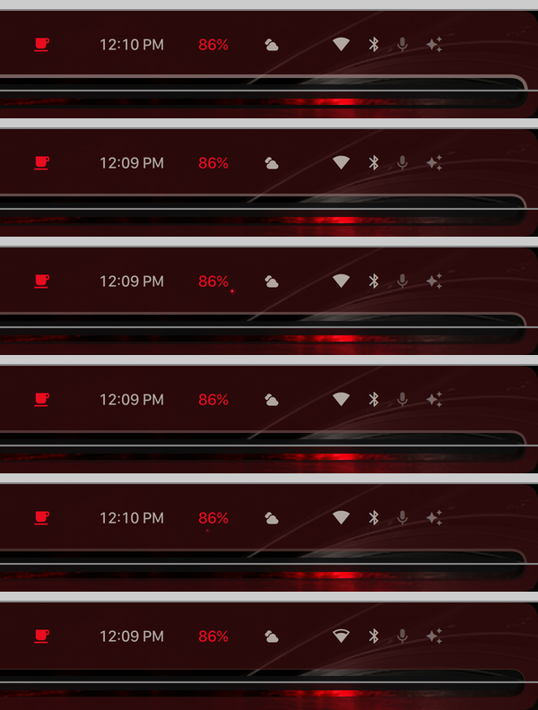
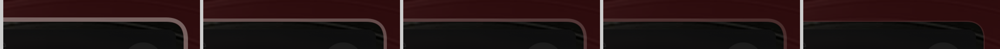
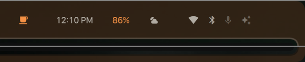
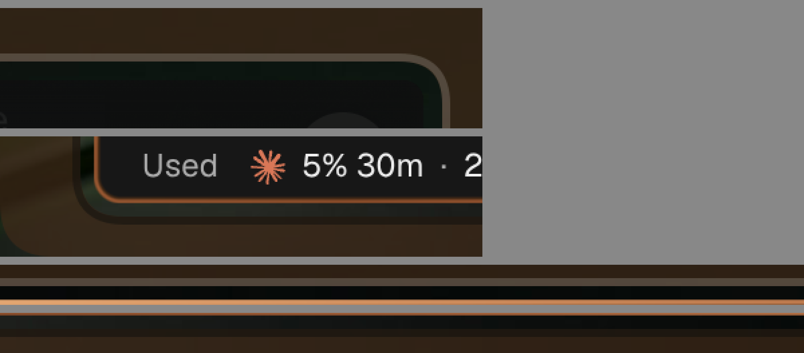

# Bar Stage 32: bevel overshot, then pulled back (2026-11-26)

Built by Claude Sonnet 5.5 from `docs/omarchy-bar-refined-brief.md` and `docs/omarchy-bar-stage-32-brief.md`, with `docs/reference/omarchy-shell-frame-diagram.html` as the frame reference. The brief was downloaded into `docs/` first and is committed with this report.

**Shipped:** `bevel-width = 3`, `bevel-light = 0.20`, `bevel-dark = 0.50` (in `shell.toml` `[frame]`). That is the only change: no QML edit, no restart. The tokens hot-reload.

**Not touched:** `frame.tint = 0.22`, depths 75/30/15/15, radii 20/16, reserves `[30, 75, 15, 15]`, the Stage 30 odd-even fill (opening and notch are real holes), the Stage 31 bevel code (one theme-derived stroke on the hull side of the opening: foreground highlight on top, background shadow at the bottom), the bar, the left numbers, binds, the float default and the pickers. No hard line.

## Why Stage 31 was invisible

At 1px (2 physical px) and 0.10, the highlight was +20 over the hull and only two device pixels tall. That's measurable in a pixel read, but it disappears at viewing distance. The bottom row of the comparison below shows it: at normal scale there is nothing to see.

## Every step tried (Afterburn Redline, x 600; hull (42, 9, 11))

Pixel colours are taken from the middle of the bevel band. Width is in logical px (×2 physical).

| Width | Light | Dark | Top highlight | Bottom shadow | Judgement |
|---|---|---|---|---|---|
| 1 | 0.10 | 0.35 | (62, 31, 32) | (32, 10, 11) | Stage 31: invisible at viewing distance |
| **4** | **0.40** | **1.0** | **(118, 96, 95)** | **(12, 13, 11)** | **Overshoot: unmistakably too much.** A grey outline around the whole opening; reads as a drawn frame line |
| 3 | 0.30 | 0.80 | (99, 75, 74) | (19, 12, 11) | Still too much: a clear light rim, line-like |
| 3 | 0.25 | 0.65 | (89, 64, 63) | (23, 11, 11) | Borderline: the rim still reads as a line on the top corners |
| **3** | **0.20** | **0.50** | **(80, 53, 53)** | **(27, 11, 11)** | **Shipped:** the top edge catches light, softly; reads as a bevel, not a line |
| 3 | 0.15 | 0.40 | (71, 42, 42) | (30, 10, 11) | Still visible but faint; heading back toward Stage 31's invisible |

The first overshoot I ran (3 / 0.30 / 0.80) was visible but not obviously wrong, so per the brief I went bigger (4 / 0.40 / 1.0). That is the top of the range: **"too much" starts at 0.25–0.30 light.**

At every step: desktop pixel (1940, 1500) = (88, 0, 0), unchanged; notch (1728, 40) = (0, 1, 0), still a hole; hull (600, 100) = (42, 9, 11), tint unchanged. The opening pixel right next to the bevel (600, 150) stays the wallpaper's (0, 1, 0): the stroke never crosses onto the desktop.

## Why 3 / 0.20 / 0.50

It is the strongest step that does not read as a line. 0.25 and above draw an outline; 0.15 starts to fade back toward invisible. The 3px width does most of the work. A wider, softer band reads as an edge catching light, while a narrow bright one reads as a drawn line. That's why 1px at any alpha looked either like nothing or like a hairline.

## Verified on Afterburn default (then Redline restored)

| Check | Result |
|---|---|
| Top highlight (600, 146) | **(83, 71, 60)** against the hull (46, 32, 19) |
| Bottom shadow (600, 2206) | **(31, 24, 17)** against the bottom band (48, 34, 22) |
| Desktop (1940, 1500) | **(9, 14, 7)**: untinted, the same as Stages 30 and 31 |
| Notch (1728, 40) | **(7, 11, 10)**: still a hole |
| Hull (600, 100) | **(46, 32, 19)**: tint 0.22 unchanged |
| Top row ink centres | time, battery, weather 37.75; Wi‑Fi 37.25 (odd ink heights at the 0.5px grid limit); title 37.75 (odd height); Bluetooth, mic, agents **37.5**. Unchanged from Stage 31 |
| Left numbers | x-centres **14.75 / 15.25** on the 30px band; active accent visible |
| Reserves | `[30, 75, 15, 15]` |

Theme restored: **Afterburn Redline**, as you left it.

## Honest note on the shadow side

The highlight does the work. The bottom shadow is real, but it is only obvious where the hull meets something lighter than itself. On both dark wallpapers the opening is near-black, so a darker hull edge mostly reads as "the opening is slightly bigger" rather than as a shadow. On Afterburn it shows as a darker lip under the bottom band (31 vs 48); on Redline, against black, you won't notice it. Raising `bevel-dark` won't fix that, because 1.0 was already tried in the overshoot. If you want the bottom to read too, that would need a different technique (for example a light catch on the bottom band's *outer* side). That is a design call for a later stage, not something to add unasked.

## Build checklist

| Step | Result |
|---|---|
| Build start | `omarchy-kbd-backlight hold` (saved 0), `omarchy toggle idle stay-awake` |
| Backup | **`~/.local/state/omarchy-launcher-backups/20261126-120927-bar-stage-32`**: mode 700, **2,403 files**, 872 MB, local only, taken before any change. Same scope as Stages 30 and 31: all `~/.config/hypr`, all `~/.config/omarchy` (every plugin including `jimmy.*`, themes, themed, hooks, backgrounds, `shell.json`, `shell.toml`), `~/.config/systemd`, `~/.config/vicinae/settings.json`, `~/.local/bin`, and the saved `toggles` and `workspace-layouts`. Live before = backup |
| Excluded (named) | `*.bak*`, `__pycache__`, symlinks (`afterburn-watch`, `orca-ide`, `superwhisper`), and all runtime state (clipboard history, images and pins, emoji pins and recents, the pause flag, notifications, agents, indicators, scratchpad). Nothing from runtime state in git |
| Live after | `sha256sum -c` against the backup: only `shell.toml` differs. The theme round trip left no tracked file changed |
| Reloads | None needed: tokens and theme switches hot-reloaded. No shell restart, no `hyprctl reload`, never `refresh` |
| Health | `hyprctl configerrors` empty; no `jimmy.frame` errors |
| Build end | `omarchy toggle idle allow-idle`, `omarchy-kbd-backlight release` (level 0, auto resumes) → **`"enabled":true,"stayAwake":false`** |
| Snapshot | `config/omarchy/shell.toml` equals live; `plugins/jimmy.frame/Frame.qml` unchanged and equal to live |

## Files changed

- `~/.config/omarchy/shell.toml`: `bevel-width 1 → 3`, `bevel-light 0.10 → 0.20`, `bevel-dark 0.35 → 0.50`.
- `config/omarchy/shell.toml` (snapshot), `docs/omarchy-bar-stage-32-brief.md`, this report, `docs/reports/bar-stage-32/*.png` (frame-only crops).
