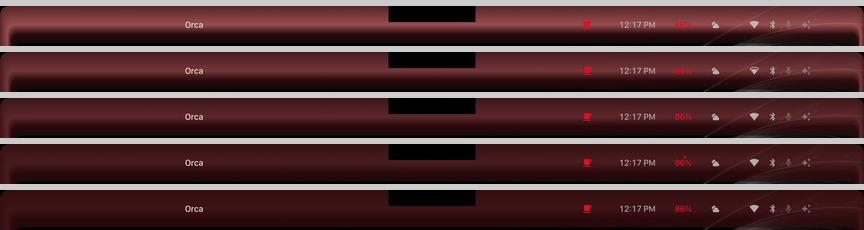
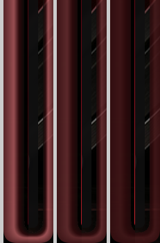
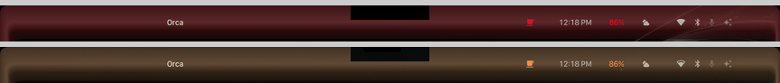
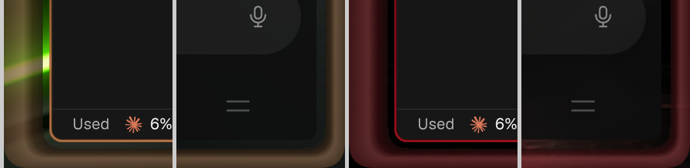

# Bar Stage 33: the bevel is the hull (2026-11-26)

Built by Claude Sonnet 5.5 from `docs/omarchy-bar-refined-brief.md` and `docs/omarchy-bar-stage-33-brief.md`, with `docs/reference/omarchy-shell-frame-diagram.html` **v6** as the frame reference. Both were downloaded first. v6 replaced v5 at the same path; v5 is in git history.

**Shipped:** a full-depth molding across every hull band, `frame.bevel-light = 0.40`, `frame.bevel-dark = 0.55`. **The Stage 31–32 inner-edge stroke is gone.**

**Not touched:** `frame.tint = 0.22` (the bevel did not force a change), depths 75/30/15/15, radii 20/16, reserves `[30, 75, 15, 15]`, the opening and notch as real holes, the bar (`Bar.qml` unchanged), the left numbers, binds, the float default and the pickers. No hard line.

## Audit: how the hull was drawn, and how it is now

**Before (Stage 32):** `jimmy.frame/Frame.qml` drew the hull as one `Canvas` path: outer rounded rect (r 20), inner rounded opening (r 16) and the notch rect, filled once with flat `glass` under `Qt.OddEvenFill`. The bevel was a separate 3px gradient **stroke** on the hull side of the opening edge. The hull surface itself was flat.

**Now:** the hull is painted as **concentric rounded rings** from the screen edge inward to the opening. Each ring is the outer rect interpolated toward the opening at `t` (0 = screen edge, 1 = opening), including the radius (20 → 16), so:

- **Every band is shaded across its full depth.** Top 75, left 30, right 15 and bottom 15 each run the same profile, scaled to their own depth.
- **The corners follow the rounded shape.** The shading turns the corner with the radius; there is no mitre seam.

Each ring fills everything from its edge to the opening (odd-even, so the opening stays a hole) with `globalCompositeOperation = "copy"`. Each inner ring replaces the one before it, so rings meet without seams or stacked alpha. The ring count equals the deepest band (75), which gives 1 logical px steps on the top band. The notch is then cleared (`clearRect`), so it stays a real hole. The canvas only repaints when a token, the theme or the size changes.

**Profile (the brief's words, the v6 picture):** surface height `h(t)` is **0.7 at the screen edge** (stays high, running off the screen), rises to **1.0, the ridge, mid-band**, and falls to **0 at the opening**. Height maps to shade: above half height mixes the glass toward the light colour (up to `bevel-light` at the ridge); below half height mixes it toward the dark colour (up to `bevel-dark` at the foot). Light = theme accent warmed with 50% foreground (the diagram's peach on Afterburn); dark = theme background. No literal colours. The fill alpha stays the launcher glass alpha.

**Direction:** I kept the brief's direction (high outer edge, ridge, falling to the opening). Live, it reads as a raised molding with the light on the ridge and the opening sunk below it, so I did not flip it.

### What happened to the Stage 31–32 tokens

- `bevel-light` and `bevel-dark` were **repurposed** as the hull bevel strengths: how far the ridge moves toward the light colour and the foot toward the dark colour.
- `bevel-width` was **removed**, from both `shell.toml` and the code. The stroke code is deleted, so only one bevel exists.

## Every step tried (Afterburn Redline)

Top band at x 1200 logical, sampled at the screen edge (y 2), mid-band (y 37, the ridge) and the inner edge (y 72). The flat Stage 30 hull here is (42, 9, 11).

| Light / dark | Top outer y2 | Top ridge y37 | Top inner y72 | Left ridge x15 | Desktop | Judgement |
|---|---|---|---|---|---|---|
| **0.90 / 0.90 (overshoot)** | (90, 39, 41) | **(151, 77, 80)** | (16, 9, 8) | (147, 75, 78) | (88, 0, 0) | **Unmistakably too much:** a pink chrome molding; the battery "86%" and active "1" (accent red) wash out on the ridge |
| 0.60 / 0.70 | (74, 29, 31) | (114, 54, 57) | (22, 9, 9) | (112, 53, 56) | (88, 0, 0) | Still too strong; accent text weakening |
| **0.40 / 0.55: shipped** | **(64, 22, 25)** | **(91, 39, 41)** | **(26, 9, 9)** | **(89, 38, 41)** | **(88, 0, 0)** | **Reads as a beveled molding at a glance:** ridge, outer edge high, the opening sunk. Text fully legible |
| 0.25 / 0.40 | (55, 18, 20) | (72, 28, 30) | (31, 9, 10) | (71, 27, 29) | (88, 0, 0) | Still a molding, but quieter. Risk of "I don't see it" again |
| 0.15 / 0.30 | (51, 14, 16) | (60, 20, 22) | (34, 9, 10) | (60, 20, 22) | (88, 0, 0) | Close to flat |

At every step: desktop (1940, 1500) = (88, 0, 0), the wallpaper, untinted; notch (1728, 40) = (0, 1, 0), a hole; reserves `[30, 75, 15, 15]`.

## Why 0.40 / 0.55

It is the first step down from "too much" where the surface clearly reads as a molding at viewing distance on all four bands and around the corners. It is not a flat tinted border, and not a chrome frame. The accent-coloured elements on the ridge (battery %, active workspace number) stay legible. 0.25 also reads, but given that James could not see Stages 31–32, I shipped the step that is unmistakable without being chrome. If it is a touch strong, 0.30 / 0.45 is the next step down; the token hot-reloads.

## Verified on Afterburn default (then Redline restored)

| Check | Result |
|---|---|
| Top band outer / ridge / inner | **(69, 50, 35) / (95, 73, 54) / (29, 23, 16)**: a warm bronze molding |
| Left band outer / ridge / inner | (72, 54, 37) / (98, 75, 56) / (33, 26, 18) |
| Right band in / ridge / out | (58, 47, 33) / (109, 89, 67) / (83, 67, 49) |
| Bottom band in / ridge / out | (40, 28, 17) / (95, 74, 54) / (70, 52, 36) |
| Desktop (1940, 1500) | **(9, 14, 7)**: untinted, the same as Stages 30–32 |
| Notch (1728, 40) | **(7, 11, 10)**: a hole |
| Top row | `Bar.qml` unchanged. Ink centres measured 37.25–37.75 (title, time, battery, weather 37.75; Wi‑Fi 37.25; Bluetooth 37.5). Mic and agents read ±0.25 depending on the threshold, because the band behind them is now a gradient; their position code is unchanged |
| Left numbers | x-centres **14.75 / 15.25** on the 30px band; the active "1" in accent stays readable on the ridge |
| Reserves | `[30, 75, 15, 15]` |

Theme restored: **Afterburn Redline**.

## Build checklist

| Step | Result |
|---|---|
| Build start | `omarchy-kbd-backlight hold` (saved 0), `omarchy toggle idle stay-awake` |
| Backup | **`~/.local/state/omarchy-launcher-backups/20261126-121639-bar-stage-33`**: mode 700, **2,403 files**, 872 MB, local only, taken before any change. Same scope as Stages 30–32: all `~/.config/hypr`, all `~/.config/omarchy` (every plugin including `jimmy.*`, themes, themed, hooks, backgrounds, `shell.json`, `shell.toml`), `~/.config/systemd`, `~/.config/vicinae/settings.json`, `~/.local/bin`, and the saved `toggles` and `workspace-layouts`. Live before = backup |
| Excluded (named) | `*.bak*`, `__pycache__`, symlinks (`afterburn-watch`, `orca-ide`, `superwhisper`), and all runtime state (clipboard history, images and pins, emoji pins and recents, the pause flag, notifications, agents, indicators, scratchpad). Nothing from runtime state in git |
| Live after | `sha256sum -c` against the backup: only `jimmy.frame/Frame.qml` and `shell.toml` differ. The theme round trip left no tracked file changed |
| Reloads | **One `omarchy restart shell`**, on its own, for the QML change. Token steps and theme switches hot-reloaded. Never `refresh` |
| Health | `hyprctl configerrors` empty; no `jimmy.frame` QML errors; `console.log` = 0 |
| Build end | `omarchy toggle idle allow-idle`, `omarchy-kbd-backlight release` (level 0, auto resumes) → **`"enabled":true,"stayAwake":false`** |
| Snapshot | `plugins/jimmy.frame/Frame.qml`, `config/omarchy/shell.toml` equal live |

## Files changed

- `~/.config/omarchy/plugins/jimmy.frame/Frame.qml`: the flat fill and the inner-edge stroke are replaced by the ring-painted full-depth molding (`shade(t)` profile, theme-derived light and dark, `copy` compositing, notch cleared). The Stage 30 odd-even holes are kept.
- `~/.config/omarchy/shell.toml`: `bevel-light 0.40`, `bevel-dark 0.55` (repurposed); `bevel-width` removed; comment updated.
- Repo snapshots of both; `docs/omarchy-bar-stage-33-brief.md`; `docs/reference/omarchy-shell-frame-diagram.html` (v6); this report; `docs/reports/bar-stage-33/*.png` (frame-only crops).

## For your eye

- **Strength:** 0.40 / 0.55 is shipped. 0.25 / 0.40 is the quieter option; 0.60 / 0.70 starts to wash out accent text.
- **Profile shape** is fixed in code (edge 0.7, ridge mid-band, foot 0). If you want the ridge nearer the outer edge or the inner slope longer, that is a one-line change to `shade(t)`.
- **Direction** was kept as briefed: light on the ridge, the opening sunk. It reads correctly live, so it was not flipped.
