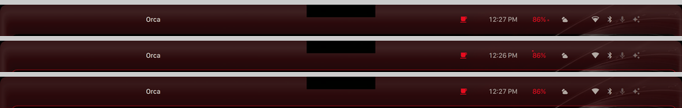
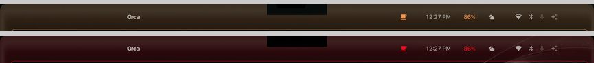
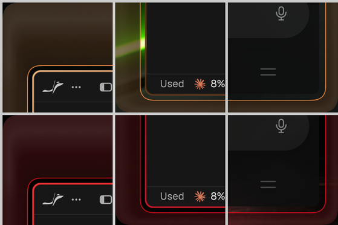
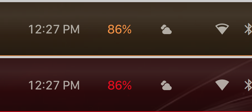
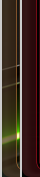

# Bar Stage 34 (revised): soft warm-glass hull and a hard boundary line (2026-11-26)

Built by Claude Sonnet 5.5 from `docs/omarchy-bar-refined-brief.md` and the revised `docs/omarchy-bar-stage-34-brief.md`, with `docs/reference/omarchy-shell-frame-diagram.html` (v6) as the frame reference. The brief was downloaded first. The cancelled "black + hard edge" Stage 34 was **not** built.

**Shipped:**
- `bevel-light 0.15`, `bevel-dark 0.30`, `bevel-sides 0.5`.
- Light from **foreground** (glass catching light), dark from background.
- Ridge at **25%** from the screen edge, then a long slope to the opening.
- A **1px accent hard line at 0.85** around the opening.

**Not touched:** `frame.tint = 0.22`, depths 75/30/15/15, radii 20/16, reserves `[30, 75, 15, 15]`, the opening and notch holes, `Bar.qml`, the left numbers, binds, the float default and the pickers. No black.

## Audit: what Stage 33 drew, and what changed

Stage 33's `Frame.qml` painted the hull as 75 concentric rounded rings, from the screen edge to the opening, with `copy` compositing. Each ring was coloured by `shade(t)`: edge 0.7, **ridge 1.0 mid-band**, foot 0. The light colour was **accent warmed with 50% foreground**, at 0.40 / 0.55, the same on all four bands. The ring method stays (it follows the corners without seams). What changed:

| | Stage 33 | Stage 34 |
|---|---|---|
| Light colour | accent + 50% foreground (pink on Redline, bronze on Afterburn) | **`Commons.Color.foreground`**: the glass lit, no hue of its own |
| Dark colour | background | background (unchanged) |
| Profile | edge 0.7 → ridge 1.0 at t 0.5 → 0 | **edge 0.8 → ridge 1.0 at t 0.25 → long linear slope to 0** at the opening |
| Strength | 0.40 / 0.55 on every band | **0.15 / 0.30 on the top band**; left, right and bottom at **`bevel-sides` 0.5×** |
| Hard line | none | **1px accent at 0.85**, on the hull side of the opening edge (it never covers the desktop) |

**How the half-strength sides work without a seam:** each ring's fill is a vertical gradient. It is full strength down to the opening's top edge (y 75), then eases to the side strength over the top corners (y 75 → 107), and stays at the side strength below that. The top band carries the bevel, and the left, right and bottom bands run quieter, with one continuous surface through the corners.

**Tokens:** `bevel-light` and `bevel-dark` are kept as strengths. **`bevel-sides`** is new. **`edge`** (the boundary line's alpha) is back, as the hard line this time, not the Stage 28 hairline.

## Every step tried (Afterburn Redline; flat hull (42, 9, 11))

| Strength (top / sides) | Ridge | Light source | Hard line | Top outer y1 / ridge y19 / inner y72 | Line pixel | Desktop | Text | Judgement |
|---|---|---|---|---|---|---|---|---|
| **0.15 / 0.30, sides 0.5: shipped** | t 0.25 | foreground | 1px, 0.85 | **(54, 23, 25) / (60, 31, 32) / (33, 9, 10)** | **(202, 11, 27)** | (88, 0, 0) | Battery %, time, weather, active "1": all crisp | The top reads as dark glass lit along the outer edge and falling toward the desktop. It is clearly visible, not a molding and not pink. The line marks the boundary |
| 0.10 / 0.20, sides 0.5 | t 0.25 | foreground | 1px, 0.85 | (50, 18, 20) / (54, 24, 25) / (37, 9, 11) | (202, 11, 28) | (88, 0, 0) | All crisp | Visible but faint: the band nearly flattens next to the line. Too quiet to ship as "clearly visible" |
| 0.15 / 0.30, no line (check) | t 0.25 | foreground | off | (54, 23, 25) / (60, 31, 32) / (33, 9, 10) | (32, 9, 10) | (88, 0, 0) | All crisp | The bevel alone reads softly; the line adds the boundary without fighting it |

Narrow bands at the shipped step (Redline): left outer / ridge / inner = (48, 16, 18) / (51, 20, 21) / (38, 9, 11); bottom = (49, 18, 18) / (52, 21, 22) / (42, 10, 11). That is half the top band's swing, so the frame reads from the top.

**0.10 is not invisible, so the profile is not wrong.** It is just too quiet next to a hard line. The line and the bevel do not fight: the line sits at the foot of the slope, where the hull is darkest, so it reads as the hull's edge rather than a second shape.

At every step: desktop (1940, 1500) = (88, 0, 0), untinted; notch (1728, 40) = (0, 1, 0), a hole; reserves `[30, 75, 15, 15]`.

## Verified on Afterburn default (then Redline restored)

| Check | Afterburn | Redline |
|---|---|---|
| Top outer / ridge / inner | (58, 45, 32) / (64, 51, 40) / (36, 27, 17) | (54, 23, 25) / (60, 31, 32) / (33, 9, 10) |
| Hard line | (213, 126, 61): accent | (202, 11, 27): accent |
| Desktop | **(9, 14, 7)**, untinted | **(88, 0, 0)**, untinted |
| Notch | (7, 11, 10), a hole | (0, 1, 0), a hole |
| Reads as | **warm dark glass catching light**: no bronze molding | **dark glass catching light**: no pink |

The ridge moves toward neutral light (R, G and B rise together) rather than toward a hue on either theme. Neither goes pink.

Top row (`Bar.qml` unchanged), with crops that exclude the new line at y 74.5: title 37.75, time 37.5, battery 37.75, weather 37.75, Wi‑Fi 37.25, Bluetooth 37.25, agents 37.5. These are all within ±0.25 of 37.5 (odd ink heights and threshold noise over the gradient). Left numbers: x-centres **14.75 / 15.25** on the 30px band. All accent text is fully legible on both themes.

## Why this step

It is the softest step that is still clearly visible at a glance. The top band reads as lit glass falling toward the desktop, and the narrow bands stay quiet, so the frame reads from the top. No accent text washes out, and nothing reads as chrome or pink. The hard line gives the boundary you asked for. It is accent at 0.85, so it is unmistakable on both themes.

## Build checklist

| Step | Result |
|---|---|
| Build start | `omarchy-kbd-backlight hold` (saved 0), `omarchy toggle idle stay-awake` |
| Backup | **`~/.local/state/omarchy-launcher-backups/20261126-122612-bar-stage-34`**: mode 700, **2,403 files**, 872 MB, local only, taken before any change. Same scope as Stages 30–33: all `~/.config/hypr`, all `~/.config/omarchy` (every plugin including `jimmy.*`, themes, themed, hooks, backgrounds, `shell.json`, `shell.toml`), `~/.config/systemd`, `~/.config/vicinae/settings.json`, `~/.local/bin`, and the saved `toggles` and `workspace-layouts`. Live before = backup |
| Excluded (named) | `*.bak*`, `__pycache__`, symlinks (`afterburn-watch`, `orca-ide`, `superwhisper`), and all runtime state (clipboard history, images and pins, emoji pins and recents, the pause flag, notifications, agents, indicators, scratchpad). Nothing from runtime state in git |
| Live after | `sha256sum -c` against the backup: only `jimmy.frame/Frame.qml` and `shell.toml` differ. The theme round trip left no tracked file changed |
| Reloads | **One `omarchy restart shell`**, on its own, for the QML change. Token steps and theme switches hot-reloaded. Never `refresh` |
| Health | `hyprctl configerrors` empty; no `jimmy.frame` QML errors; `console.log` = 0 |
| Build end | `omarchy toggle idle allow-idle`, `omarchy-kbd-backlight release` (level 0, auto resumes) → **`"enabled":true,"stayAwake":false`** |
| Snapshot | `plugins/jimmy.frame/Frame.qml`, `config/omarchy/shell.toml` equal live |

## Files changed

- `~/.config/omarchy/plugins/jimmy.frame/Frame.qml`: light = foreground; `shade(t)` with the ridge at t 0.25 and a long slope; per-ring vertical gradient (top full strength → sides at `bevel-sides`); 1px accent hard line on the hull side of the opening.
- `~/.config/omarchy/shell.toml`: `bevel-light 0.15`, `bevel-dark 0.30`, `bevel-sides 0.5`, `edge 0.85`; comments updated.
- Repo snapshots of both; `docs/omarchy-bar-stage-34-brief.md`; this report; `docs/reports/bar-stage-34/*.png` (frame-only crops).

## For your eye

- The hard line sits about 7px outside each window's own active border. On Redline both are red, so the opening shows two red lines close together. That's expected with a boundary line, but if it reads busy, `edge` is one token (try 0.6), or the line could take the foreground colour instead of accent.
- If the bevel is too quiet, 0.20 / 0.40 is the next step up; 0.40 was Stage 33's chrome.
