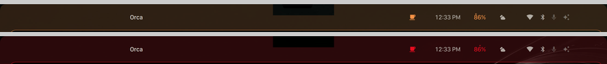
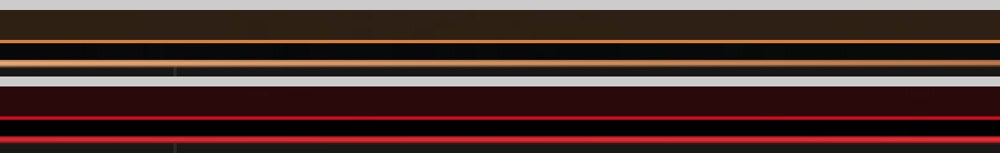
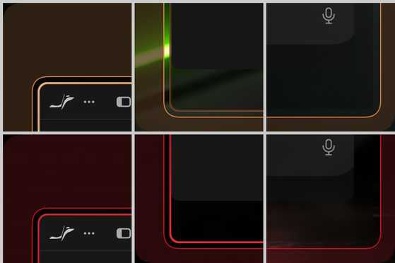
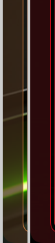

# Bar Stage 35: the bevel is out (flat tinted hull + hard line) (2026-11-26)

Built by Claude Sonnet 5.5 from `docs/omarchy-bar-refined-brief.md` and `docs/omarchy-bar-stage-35-brief.md`, with `docs/reference/omarchy-shell-frame-diagram.html` as the frame reference. The brief was downloaded first.

**The frame is now:** one flat tinted hull (Stage 30 fill) plus the 1px accent hard line at 0.85 (unchanged from Stage 34). **No gradient, bevel, ridge, slope or molding remains anywhere on the frame.**

**Not touched:** `frame.tint = 0.22`, depths 75/30/15/15, radii 20/16, reserves `[30, 75, 15, 15]`, the opening and notch holes, `Bar.qml`, the left numbers, binds, the float default and the pickers.

## Audit: what was live, and what changed

Live `jimmy.frame/Frame.qml` at build start (Stage 34) painted:

1. **75 concentric rounded rings** from the screen edge to the opening, with `globalCompositeOperation = "copy"`. Each ring's fill was a **vertical linear gradient** built from `shade(t)` (edge 0.8, ridge at t 0.25, slope to 0), `tone()` and `mix()`, toward `bevelLight` (foreground) or `bevelDark` (background), at `bevel-light` / `bevel-dark`, with `bevel-sides` on the narrow bands.
2. The 1px accent line on the hull side of the opening.
3. `clearRect` for the notch.

**Removed:**
- The ring loop, the `copy` compositing, the per-ring gradients, and `shade()` / `tone()` / `mix()`.
- The properties `bevelLight`, `bevelDark`, `bevelLightMix`, `bevelDarkMix`, `bevelSides`, and their `on…Changed` repaint handlers.
- The notch `clearRect`: the notch is a path hole again, as in Stage 30.

**Kept / restored:**
- **Fill:** one path (outer rounded rect r 20, inner opening r 16, notch rect), `ctx.fillRule = Qt.OddEvenFill`, filled once with `glass` = `Qt.tint(background, accent @ frame.tint)` at the launcher glass alpha. This is exactly the Stage 30 fill.
- **Hard line:** unchanged from Stage 34. 1px, `Commons.Color.accent` at `frame.edge` 0.85, stroked on the hull side of the opening (rect inset by −0.5, radius 16.5), so it never covers the desktop. It needed no change to sit on the flat hull.

`Frame.qml` is 68 lines shorter.

## Tokens

| Token | Stage 34 | Stage 35 |
|---|---|---|
| `frame.bevel-light` | 0.15 | **removed** (`shell.toml` and code) |
| `frame.bevel-dark` | 0.30 | **removed** (`shell.toml` and code) |
| `frame.bevel-sides` | 0.5 | **removed** (`shell.toml` and code) |
| `frame.tint` | 0.22 | **0.22**, kept |
| `frame.edge` | 0.85 | **0.85**, kept (the hard line) |

No bevel token is left in `shell.toml` or `Frame.qml` (`grep bevel` returns nothing in either).

## Verified live (one `omarchy restart shell` for the QML change)

| Sample | Redline | Afterburn |
|---|---|---|
| Top band, outer / y19 / y45 / inner (x 1200) | **(42, 9, 11)** at all four | **(47, 32, 20) / (46, 32, 20) / (46, 32, 20) / (46, 32, 20)** |
| Left band, outer / middle / inner (y 1600) | **(42, 9, 11)** at all three | (49, 35, 22) / (49, 35, 23) / (51, 36, 23) |
| Bottom band, inner / middle / outer | (43, 10, 11) at all three | (46, 32, 20) / (48, 35, 22) / (47, 33, 21) |
| Hard line (y 74.5 / x 29.5) | **(203, 11, 28)** | **(215, 127, 62)** |
| Desktop (1940, 1500) | **(88, 0, 0)**: untinted | **(9, 14, 7)**: untinted |
| Notch (1728, 40) | (0, 1, 0): a hole | (7, 11, 10): a hole |

The hull is flat across every band. The 1–2 unit wobble on Afterburn's left, bottom and right bands is the wallpaper showing through the 0.70 glass, not a gradient: the fill is a single colour.

**Top row** (`Bar.qml` unchanged; crops exclude the line): title 37.75, time 37.75, battery "86%" 37.75, weather 37.75, Wi‑Fi 37.25, Bluetooth 37.5, agents 37.25–37.5, on both themes. All within ±0.25 of 37.5 (odd ink heights). Everything is fully legible, including the accent battery % and the active "1". **Left numbers:** x-centres 14.75 / 15.0–15.25 on the 30px band. **Reserves:** `[30, 75, 15, 15]`.

Theme restored: **Afterburn Redline**.

## The double-line note (from Stage 34)

On a flat hull, the hard line stands out more than it did over the bevel. Around the **focused** window it runs about 7px outside that window's own active border. **On Redline both are red, so the focused window reads as double-outlined, and that is somewhat busy.** On Afterburn the window border and the line are both orange, so the same effect shows, softer. Inactive windows have no accent border, so there you see only the hull line, which reads cleanly as the frame's boundary. Per the brief, **the line was not changed.** If it bothers you, the options are a lower `frame.edge` (e.g. 0.5), or taking the line's colour from foreground instead of accent.

## Build checklist

| Step | Result |
|---|---|
| Build start | `omarchy-kbd-backlight hold` (saved 0), `omarchy toggle idle stay-awake` |
| Backup | **`~/.local/state/omarchy-launcher-backups/20261126-123239-bar-stage-35`**: mode 700, **2,403 files**, 872 MB, local only, taken before any change. Same scope as Stages 30–34: all `~/.config/hypr`, all `~/.config/omarchy` (every plugin including `jimmy.*`, themes, themed, hooks, backgrounds, `shell.json`, `shell.toml`), `~/.config/systemd`, `~/.config/vicinae/settings.json`, `~/.local/bin`, and the saved `toggles` and `workspace-layouts`. Live before = backup |
| Excluded (named) | `*.bak*`, `__pycache__`, symlinks (`afterburn-watch`, `orca-ide`, `superwhisper`), and all runtime state (clipboard history, images and pins, emoji pins and recents, the pause flag, notifications, agents, indicators, scratchpad). Nothing from runtime state in git |
| Live after | `sha256sum -c` against the backup: only `jimmy.frame/Frame.qml` and `shell.toml` differ. The theme round trip left no tracked file changed |
| Reloads | **One `omarchy restart shell`**, on its own. Never `refresh` |
| Health | `hyprctl configerrors` empty; no `jimmy.frame` QML errors; `console.log` = 0 |
| Build end | `omarchy toggle idle allow-idle`, `omarchy-kbd-backlight release` (level 0, auto resumes) → **`"enabled":true,"stayAwake":false`** |
| Snapshot | `plugins/jimmy.frame/Frame.qml`, `config/omarchy/shell.toml` equal live |

## Files changed

- `~/.config/omarchy/plugins/jimmy.frame/Frame.qml`: all bevel code removed; Stage 30 flat odd-even fill restored; hard line unchanged; header comment updated.
- `~/.config/omarchy/shell.toml`: `bevel-light`, `bevel-dark`, `bevel-sides` and their comment removed; `tint 0.22` and `edge 0.85` kept.
- Repo snapshots of both; `docs/omarchy-bar-stage-35-brief.md`; this report; `docs/reports/bar-stage-35/*.png` (frame-only crops).
