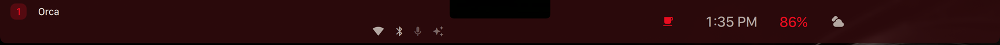
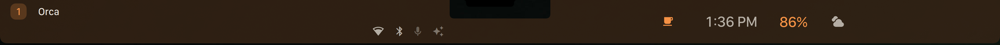
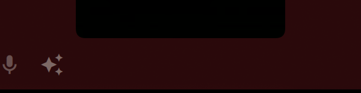

# Top Bar v1 (Stage 37): one deep bar across the top (2026-11-26)

Built by Claude Sonnet 5.5 from `docs/omarchy-bar-refined-brief.md` and `docs/omarchy-bar-topbar-v1-brief.md`. The brief was downloaded first. The theme stays **Afterburn Redline**.

**Built:**
- One flat, tinted bar, **75px deep**, across the top, with the **notch cut out of it**.
- The two ears nest round the notch and are **joined by the band below it**.
- **Left ear, two levels:** workspaces + focused title on top, Wi‑Fi / Bluetooth / mic / agents below.
- **Right ear:** time, battery and weather, larger.
- The left strip is gone.
- Reserves **`[0, 75, 0, 0]`**; windows start at **y 82**.

No frame, hull, bevel or hard line.

## Audit: how it was drawn, and how it is drawn now

**Before (the restored islands, Stage 27 code):**
- `jimmy-bar` was a 68px layer holding three glass `Island` pills, each a `Rectangle` with an accent outline and an `IslandGlow`:
  - the title island in the left ear;
  - the main right island (time, battery, weather, lights) centred in the right ear;
  - the status island joined to its right.
- `jimmy-strip` was the 30px workspace strip down the left edge, the source of the left reserve of 32.
- `jimmy-bar-reserve` reserved `bar.height − notch` on top of `monitors.lua`'s 32.

**Now (`jimmy.bar/Bar.qml`):**
- **The bar is one `Canvas`.** A full-width rectangle `bar.height` (75) deep, with the bottom corners at `island.radius` (13). The notch is a second subpath, 174 × 32 with bottom corners at `notch.radius` (8), filled with `ctx.fillRule = Qt.OddEvenFill`, so it is a real cut-out (the Stage 30 lesson). It repaints only when the colour, notch or width changes.
- **Fill:** `Qt.tint(background, accent @ bar.tint 0.22)` at the launcher glass alpha (0.70), derived from the theme. Strong enough to see the bar and the notch at a glance.
- **Islands are now layout groups, not pills.** `Island` became a plain `Item` with a `Row`; no fill, outline or glow of its own. The bar is the surface. The joined-pair glow and the `joinLeft` / `joinRight` / `glow` plumbing were removed.
- **The left strip `PanelWindow` was removed.** Its workspace chips (occupied + active, accent tint on the active chip, click to focus) moved into the bar's top-left level as a horizontal row.
- **Reserve:** unchanged mechanism. `monitors.lua`'s 32 plus `jimmy-bar-reserve`'s 75 − 32 = 43 gives a top of 75. With no strip, left = 0.

## Layout

| Where | What | Justification | Live ink centre (y) |
|---|---|---|---|
| Left ear, **top level** (y 2–37) | Workspace chips, then the focused window's title (elides in the ear) | **Left-justified**, from `notch.corner-inset` (18) | ws "1" **20.0**, title **20.25** (level centre 19.5) |
| Left ear, **lower level** (y 37–72) | Wi‑Fi, Bluetooth, mic, agents (20px glyphs) | **Right-justified** against the notch (`notch.inset` 10), so the levels stagger | **54.0** (level centre 54.5) |
| **Band below the notch** (y 32–75, centred) | **Empty in v1.** It is a real `Row` (`id: band`) in the bar and inside its input region, centred under the cut-out, ready for elements. The fill runs through it, so the two ears read as one piece joined under the notch | centred | n/a |
| Right ear (centred in the ear) | Time **26px**, battery % **26px** (+ sparks), weather **28px** glyph, contextual lights | centred, full 75 depth | time **37.5**, battery **38.0**, weather **37.25** |

The weather glyph sat 1.75px low at 28px, so it gets a 2px optical lift (`anchors.verticalCenterOffset: -2`). Time and battery are on the 37.5 line.

The title stays with the workspaces on the top level. Dropping it would have removed an element, which v1 rules out.

## Tokens (`shell.toml`)

| Token | Value | Note |
|---|---|---|
| `bar.height` | **75** (was 48) | Depth and total top reserve |
| `bar.tint` | **0.22** (new) | Accent mix in the bar fill |
| `notch.radius` | **8** (new) | Bottom corners of the cut-out |
| `primary.text-size` / `primary.glyph-size` | **26 / 28** (new) | Right-ear primaries |
| `[strip]` | **removed** | The strip is gone |
| `status.spacing` | 20 | Now the left levels' spacing. `status.padding-x` is unused (noted in its comment) |

`jimmy.bar/manifest.json`: "Top bar" 0.4.0.

## Verified live

| Check | Result |
|---|---|
| Bar depth / reserves | `jimmy-bar` layer 1728 × 87 (75 + leader-letter overhang); `hyprctl monitors` **`[0, 75, 0, 0]`**; tiled windows at **y 82** (75 + gutter), x 7 |
| Notch | Cut-out: (1728, 30) = (0, 1, 0) on Redline, (7, 11, 10) on Afterburn. It reads as a black notch in the tinted bar |
| Bar fill / band | Redline **(42, 9, 11)** in the ears and in the band below the notch; Afterburn **(46, 31, 19)** / (46, 32, 19) |
| Desktop | Untinted: Redline (88, 0, 0); Afterburn (9, 14, 7). The pixel just below the bar is the wallpaper's own |
| Workspaces | Top-left, accent chip on the active one, legible. Only "1" is occupied right now; others appear as they are used |
| Leader Super+D | Entered the `bar` submap: **N T M A** sit on the lower level's bottom edge; **Q C B W** on the bar's bottom edge. Submap reset afterwards |
| Panels | `omarchy.clock`'s calendar drops from the right ear, under the bar. The status-light panels are hosted under the lower-left level, so they drop from there |
| Float default | Rule unchanged (1100 × 619, `center = true`). On the new usable area (1728 × 1042 below 75) it centres at **(314, 286)**: x (1728 − 1100)/2 = 314, y 75 + (1042 − 619)/2 ≈ 286. Computed, not opened. Comment updated in `float-default.lua` |
| Afterburn default | Verified as above, then **Redline restored** (`omarchy theme current` = Afterburn Redline) |
| Health | `hyprctl configerrors` empty; no `jimmy.*` QML errors (the one warning is the stock bar's existing IPC handler); `console.log` 0 |

**Not exercised live** (needs your keys or would disturb your windows): Super+L / Super+T, a real fullscreen toggle, toasts under the right ear, and opening a new floating window. The fullscreen-hide, toast-centre (`BarLayout.rightCenter`, now the right ear's group centre) and float paths are unchanged code.

## Build checklist

| Step | Result |
|---|---|
| Build start | `omarchy-kbd-backlight hold`, `omarchy toggle idle stay-awake` |
| Backup | **`~/.local/state/omarchy-launcher-backups/20261126-133313-bar-topbar-v1`**: mode 700, **2,401 files**, live = backup. Same scope as before (all hypr, all `~/.config/omarchy` including every `jimmy.*` plugin, `shell.json` / `shell.toml`, themes, systemd, vicinae, `~/.local/bin`, toggles, workspace layouts). Excluded (named): `*.bak*`, `__pycache__`, symlinks, runtime state. No runtime state in git |
| Live after vs backup | Exactly `Bar.qml`, `manifest.json`, `shell.toml`, `float-default.lua` differ |
| Reloads | Two `omarchy restart shell`, each on its own: the bar build, then the weather nudge. No `hyprctl reload` needed (no hypr setting changed, only a comment) |
| Build end | `omarchy toggle idle allow-idle`, `omarchy-kbd-backlight release` → **`"enabled":true,"stayAwake":false`** |
| Snapshot | `plugins/jimmy.bar/*`, `config/omarchy/shell.{toml,json}`, `config/hypr/{float-default,border-fx}.lua` equal live |

## What to judge by eye next

1. **Tint strength:** 0.22 shows the bar and the notch clearly on both themes. One token (`bar.tint`) if you want it stronger or quieter.
2. **The left levels:** workspaces + title top-left, status lights bottom-right of the ear by the notch. Is the stagger the right way round, or should the lights sit left and the workspaces right?
3. **Right primaries at 26 / 28:** is that "larger with room to grow", or should they go bigger?
4. **The band below the notch** is live but empty. Candidates: the quick toggles, a now-playing line, the agents mark. Your call for v2.
5. **No edge on the bar.** It reads against both wallpapers without one, so none was added.
6. **Still open from the rollback:** the active-window border shimmer on Redline (the `hypr-shiny-border` plugin) still flashes; it is untouched here.
