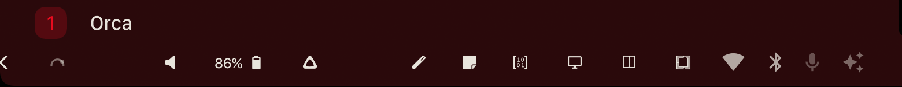

# Top Bar v2: everything in the bottom row (2026-11-26)

Built by Claude Sonnet 5.5 from `docs/omarchy-bar-refined-brief.md` and `docs/omarchy-bar-topbar-v2-brief.md`. The brief was downloaded first. The theme stays **Afterburn Redline**.

**Built:**
- The left ear is now an island with **30px padding** from the screen edge and from the notch, still in two staggered levels.
- The **bottom level holds everything**: every bar widget the layout configures that wasn't already on the bar, plus Wi‑Fi / Bluetooth / mic / agents.
- **Not touched:** the right island, the quick tiles, and the notch, which is a plain cut-out with nothing under it.

**It overflows:** the bottom row is about **146px wider** than the island. Per the brief, it was not trimmed; see "Overflow" below.

## Audit: where "everything" comes from

`jimmy.bar` in v1 drew the workspaces, title, four status lights and the right-ear primaries. It also hosted **invisibly** the stock widgets for audio, power, monitor and locus (night light), plus clock, weather, network, Bluetooth, mic and agents, so their panels and keys worked.

The full inventory of what the machine has is **`shell.json` → `bar.layout`**: every bar widget configured since the stock-bar days, in sections `left`, `center`, `centerBegin`, `centerEnd`, `right` and `tray` (the tray section is the plugin widgets).

**How v2 surfaces it (`Bar.qml`):**
- `inventoryIds` is computed from `bar.layout` (all sections, layout order).
- It leaves out only what the bar already draws its own way: clock, weather, workspaces, active window, the four status-light widgets, and the cosmetic divider.
- **Nothing hand-picked**: a widget added to the layout later appears too.
- The invisible `Hosts` helper now has a **shown** mode: a `Row` of the widgets, each drawing itself at the level's height (`barSize` = 35 for them). That is the bottom row.
- The four widgets that were hosted invisibly (audio, power, monitor, locus) are now shown there. Clock and weather stay hosted under the right ear, and the status-light widgets under the status lights, so their panels still drop from their elements.

## Bottom-row inventory (left → right; then the status lights)

| # | Widget id | From (`bar.layout`) | What it is | Width (px) |
|---|---|---|---|---|
| 1 | `omarchy.indicators` | centerBegin | Stock indicators (shows only when an indicator is active) | **0** at rest |
| 2 | `omarchy.system-update` | centerEnd | Stock system-update notice | 21 |
| 3 | `io.github.smoothpixels.glyph-menu` | left | Omarchy menu launcher mark (third-party) | 25 |
| 4 | `omarchy.tray` | right | Stock system tray (SNI apps) | 27 |
| 5 | `io.github.cwilliams5.locus` | right | Locus night light (was hosted hidden) | 27 |
| 6 | `omarchy.keyboard-layout` | right | Stock keyboard layout | 30 |
| 7 | `omarchy.audio` | right | Stock volume (was hosted hidden) | 27 |
| 8 | `omarchy.power` | right (`showPercentage`) | Stock battery / power profile (was hosted hidden). **Shows "86%" again: a duplicate of the right ear's battery** | 54 |
| 9 | `superwhisper.panel` | tray | Superwhisper dictation | 27 |
| 10 | `io.github.jondkinney.omapop` | tray | omapop (third-party). **Logs `Settings.qml` TypeErrors when it loads** | 27 |
| 11 | `omarchy-fx` | tray | Omarchy FX window effects | 27 |
| 12 | `acooper.scratchpad` | tray | Scratchpad | 21 |
| 13 | `io.github.whiskeytangofussell.matrixscreens` | tray | Matrix screensavers | 27 |
| 14 | `omarchy.monitor` | tray | Stock display / monitor (was hosted hidden) | 27 |
| 15 | `io.github.denonmaryland.tricky-tiles` | tray | Tricky Tiles | 27 |
| 16 | `lock-explorer` | tray (`type: qml`, source path) | Lock explorer. **Not loaded**: `jimmy.bar` hosts registry widgets only, and this entry is a raw QML source the stock bar resolves itself | — |
| 17 | `jimmy.menu` | tray | The launcher clone's bar icon | 27 |
| + | Wi‑Fi, Bluetooth, mic, agents | `jimmy.bar`'s own status lights | Unchanged, nearest the notch | about 122 |

**Left out, already on the bar:** `omarchy.clock` (time, right), `jimmy.weather` (right), `jimmy.workspaces` and `jimmy.active-window` (top level), `omarchy.network` / `omarchy.bluetooth` / `omarchy.microphone` / `omarchy.agents` (the status lights). **Left out as cosmetic:** `io.github.nikhill-666.divider`.

The `jimmy.bar status` IPC now lists the inventory with each widget's live width, or "not loaded" (`omarchy-shell jimmy.bar status`).

## Overflow (reported, not trimmed)

| | px |
|---|---|
| Island room: left ear 777 − 30 − 30 | **717** |
| Bottom row: widgets 421 + gaps 15 × 20 + gap 20 + status lights about 122 | **about 863** |
| **Overflow** | **about 146** (about 116 past the screen edge) |

The row is right-justified to the notch padding (its right ink edge measures **746**, target 747), so it runs off the left. The first visible widget is cut at x 0. The cut-off ones are the first in layout order (indicators / system-update / part of glyph-menu).

## The easy first trim (recommendation)

Trimming these four brings the row under 717 with about 20px to spare:

1. **`omarchy.power`** (54 + 20): duplicates the battery % on the right. Its panel, the power profile, can stay reachable from the right ear's battery (leader B).
2. **`io.github.smoothpixels.glyph-menu`** (25 + 20) and **`jimmy.menu`** (27 + 20): both open the launcher, which Super+Space already does.
3. **`omarchy.indicators`** (0 + 20): empty at rest but still takes a gap slot.

Next candidates if you want it calmer: `omarchy.keyboard-layout` (one layout), `matrixscreens`, `omarchy-fx`, `tricky-tiles` (settings-type widgets you rarely open).

## Layout check (live)

| Check | Result |
|---|---|
| Left padding | Active workspace chip starts at **x 30**; status lights end at **746** (notch 777 − 30 = 747) |
| Levels | Top: workspaces + title, left-justified. Bottom: everything, right-justified. The stagger is kept |
| Right island | **Unchanged**: time ink bbox identical to v1 (171 × 36 at the same place); 26 / 28px |
| Quick tiles | Untouched (slide out from the right island as before) |
| Notch | Clean cut-out, (0, 1, 0); the band below it is plain fill, no elements |
| Bar / reserves | 75px; **`[0, 75, 0, 0]`**; windows at **y 82**; float default unchanged at **(314, 286)** (rule unchanged) |
| Fill / desktop | Redline bar (42, 9, 11), band (42, 9, 11), desktop **(88, 0, 0)**; Afterburn bar (46, 32, 20), band (46, 32, 19), desktop **(9, 14, 7)**, notch (7, 11, 10). **Redline restored** |
| Leader Super+D | `bar` submap entered and reset. **N T M A** legible under the lights, not clipping; Q C B W unchanged on the right. The stock widgets have no letters (none were defined for them before) |
| Panels | Audio drops from its bottom-row icon (clamped at the screen edge); network drops from the Wi‑Fi light. Calendar (right ear) unchanged |
| Health | `hyprctl configerrors` empty; no `jimmy.bar` errors. **New:** omapop's own `Settings.qml` logs `TypeError: Cannot read property 'text' of undefined` when it loads (a third-party plugin, now loaded by the bar for the first time) |

**Not exercised live:** Super+L / Super+T, a fullscreen toggle, and opening a new floating window. Those code paths and rules are unchanged.

## Build checklist

| Step | Result |
|---|---|
| Build start | `omarchy-kbd-backlight hold`, `omarchy toggle idle stay-awake` |
| Backup | **`~/.local/state/omarchy-launcher-backups/20261126-135227-bar-topbar-v2`**: mode 700, **2,401 files**, live = backup; same scope as before. Excluded (named): `*.bak*`, `__pycache__`, symlinks, runtime state. No runtime state in git |
| Live after vs backup | Only `jimmy.bar/Bar.qml` and `shell.toml` differ |
| Reloads | Two `omarchy restart shell`, each on its own: the v2 build, then the status width field |
| Build end | `omarchy toggle idle allow-idle`, `omarchy-kbd-backlight release` → **`"enabled":true,"stayAwake":false`** |
| Snapshot | `plugins/jimmy.bar/Bar.qml`, `config/omarchy/shell.{toml,json}`, `config/hypr/border-fx.lua` equal live |

## Files changed

- `~/.config/omarchy/plugins/jimmy.bar/Bar.qml`:
  - `island.left-padding` replaces the 18 / 10 insets;
  - `inventoryIds` comes from `bar.layout`;
  - `Hosts` is now a `Row` with a shown mode;
  - `apiFor(id, size)`;
  - `rightHostIds` replaces `hostIds`;
  - status IPC `inventory` with widths.
- `~/.config/omarchy/shell.toml`: `[island] left-padding = 30`.
- Repo snapshot; `docs/omarchy-bar-topbar-v2-brief.md`; this report; `docs/reports/bar-topbar-v2/*.png`.
