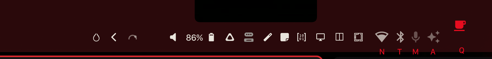

# Top Bar v3: the second level moves under the notch (2026-11-26)

Built by Claude Sonnet 5.5 from `docs/omarchy-bar-refined-brief.md` and `docs/omarchy-bar-topbar-v3-brief.md`. The brief was downloaded first. The theme stays **Afterburn Redline**.

**Built:**
- The second level is **tightened** and **moved into the band below the notch**, centred under the cut-out.
- **It fits:** 524px wide in 636px of room.
- **Omapop has its icon back:** it was a sizing bug, not a missing icon.
- **The arrow is explained:** it is the system tray's drawer chevron.
- The left island is now one row (workspaces + title). The right island, the quick tiles and the geometry are untouched.

## Audit (v2 as it was)

- **Second level (left ear, lower):**
  - a `Hosts` row of every configured bar widget not already on the bar (16 loaded, `lock-explorer` not);
  - then the four status lights;
  - right-justified 30px from the notch;
  - **20px** (`status.spacing`) between every item, on top of the padding each stock widget slot already carries (a 27px slot around a 16–18px icon).

  That double spacing is why it read as "a bunch of weird spaces", and why it overflowed by about 146px.
- **Omapop:** blank 27px slot.
- **Arrow:** a "<" at the cut-off left end.

## What changed

### Spacing: old → new

| Gap | v2 | v3 |
|---|---|---|
| Between stock widgets | 20 (`status.spacing`) | **0** (`band.widget-spacing`): each slot's own padding, about 5px a side, is the gap |
| Between the widget group and the lights, and between lights | 20 | **10** (`band.spacing`) |
| Row width | about 863 (overflowed the 717 room by about 146) | **524** |
| Room for it, under the notch (centred, between the left island and the right island) | n/a | **636**: fits, 112 spare |

The icons were not shrunk: stock widgets still draw at the level's 35px size, and the lights at 20px.

### Moved under the notch

The second level (`statusIsland`) is now **the band below the notch**:
- one row, `y` 32–75 (from the notch's bottom to the bar's), centred on the screen, so centred under the 174 × 32 cut-out;
- it spreads either side of the notch into the band.

The v1 placeholder `band` row was removed; this row replaces it. The left ear's lower level is empty, and the left island is **workspaces + title in one row**, top-left at 30px padding.

### Omapop icon

Omapop draws its own icon (`BarIcon.qml`: an action pill with three dots above a text selection). It rendered blank because its `BarWidget.qml` gave that icon `anchors.fill: parent` inside the stock `BarIconContent` loader. That loader has no size of its own, and its fallback (`if (item.width <= 0) item.width = …`) can't override an anchor, so the icon stayed 0 × 0. The same blank would appear in the stock bar.

**Fix:** removed that one anchor in `~/.config/omarchy/plugins/io.github.jondkinney.omapop/BarWidget.qml`, with a comment. The stock loader now sizes it like any other icon.
- It is **Omapop's own icon**, theme-aware (drawn in the bar foreground; dimmed while paused or waiting for Hyprland, as Omapop designed).
- **Note:** this is a local edit to a third-party plugin, which is a git checkout (`7d6b1aa`). A plugin update may overwrite it. It is worth sending upstream. The original is in the build-start backup.

### The arrow

The "<" is **`omarchy.tray`'s drawer chevron**: the stock system tray with **no pinned apps** shows only a chevron, and clicking it slides open a drawer of the tray apps.

The registered tray apps (`StatusNotifierWatcher`) are **Vicinae, Superwhisper and LocalSend**. It is not an overflow marker, so fitting the row did not remove it.

To lose the arrow, either pin the apps you want visible (the tray's `pinned` setting in `bar.layout`) so their icons show instead, or trim `omarchy.tray` entirely. Note that Superwhisper also has its own bar widget (`superwhisper.panel`) in the row, and Vicinae is the launcher being phased out.

## Inventory under the notch (left → right)

| # | Widget | What it shows at rest | px |
|---|---|---|---|
| 1 | `omarchy.indicators` | Nothing at rest (shows active indicators) | 0 |
| 2 | `omarchy.system-update` | Nothing (no updates pending) | 21 |
| 3 | `io.github.smoothpixels.glyph-menu` | Hyprland mark (the drop): opens the Omarchy menu | 25 |
| 4 | `omarchy.tray` | **"<"**: tray drawer (Vicinae, Superwhisper, LocalSend) | 27 |
| 5 | `io.github.cwilliams5.locus` | Night-light arc (↻) | 27 |
| 6 | `omarchy.keyboard-layout` | **Blank** (one layout: nothing to show) | 30 |
| 7 | `omarchy.audio` | Speaker | 27 |
| 8 | `omarchy.power` | "86%" + battery: **duplicates the right ear's battery** | 54 |
| 9 | `superwhisper.panel` | Superwhisper △ | 27 |
| 10 | `io.github.jondkinney.omapop` | **Omapop's icon (now visible)** | 27 |
| 11 | `omarchy-fx` | Pen (FX) | 27 |
| 12 | `acooper.scratchpad` | Note | 21 |
| 13 | `io.github.whiskeytangofussell.matrixscreens` | [10/01] | 27 |
| 14 | `omarchy.monitor` | Display | 27 |
| 15 | `io.github.denonmaryland.tricky-tiles` | Split | 27 |
| 16 | `jimmy.menu` | Launcher frame | 27 |
| — | `lock-explorer` | Not loaded (a raw `type: qml` source entry only the stock bar resolves) | — |
| + | Wi‑Fi, Bluetooth, mic, agents | `jimmy.bar`'s status lights | — |

`omarchy-shell jimmy.bar status` now reports `band: {width, room}` alongside the inventory widths.

## What to trim first (the easy edit)

It fits now, so trimming is about calm, not room. The clearest first cuts:

1. **`omarchy.power`**: a duplicate of the battery % on the right.
2. **`omarchy.keyboard-layout`**: blank with one layout.
3. **`omarchy.indicators` / `omarchy.system-update`**: invisible at rest. Keep them only if you want them to appear when something is up.
4. **The tray chevron**: pin or drop. Vicinae is being retired, and Superwhisper is duplicated by its own widget.
5. **`glyph-menu` and `jimmy.menu`**: both open a menu Super+Space already opens.

## Verified live

| Check | Result |
|---|---|
| Band row | Under the notch, centred, y 32–75; **524 wide / 636 room**; every loaded icon visible, Omapop included |
| Arrow | Explained (tray drawer chevron, three apps); still present by design |
| Left island | One row: workspace "1" + title, top-left at x 30 |
| Right island | Unchanged: time at the same place and line (bbox differs only with the time's text width); 26 / 28px; quick tiles unchanged. The lit stay-awake tile during the build sat right of the band, clear of it |
| Leader Super+D | **N T M A** sit on the bar's bottom edge under the lights, legible, not clipped; Q C B W unchanged |
| Panels | Audio drops from its icon under the notch; network from the Wi‑Fi light. Calendar unchanged on the right |
| Notch | Clean cut-out above the band: (0, 1, 0) Redline, (7, 11, 10) Afterburn |
| Fill / desktop | Bar and band fill (42, 9, 11) Redline, (46, 31, 19) Afterburn; desktop **(88, 0, 0)** / **(9, 14, 7)** untinted. **Redline restored** |
| Geometry | 75px bar; **`[0, 75, 0, 0]`**; windows y **82**; float rule unchanged (314, 286); tint 0.22 |
| Health | `hyprctl configerrors` empty; no `jimmy.bar` errors (the stock bar's existing IPC warning only) |

**Not exercised live:** Super+L / Super+T, a fullscreen toggle, opening the tray drawer by click, and opening a new floating window. Those paths are unchanged.

**One thing to watch:** the quick-tiles strip slides out leftward from the right island on hover. It is untouched per the brief, but at full open it can reach toward the band's right end (the band now spans about 602–1126).

## Build checklist

| Step | Result |
|---|---|
| Build start | `omarchy-kbd-backlight hold`, `omarchy toggle idle stay-awake` |
| Backup | **`~/.local/state/omarchy-launcher-backups/20261126-140038-bar-topbar-v3`**: mode 700, **2,401 files**, live = backup (includes Omapop's original `BarWidget.qml`). Excluded (named): `*.bak*`, `__pycache__`, symlinks, runtime state. No runtime state in git |
| Live after vs backup | Exactly `jimmy.bar/Bar.qml`, `shell.toml`, `io.github.jondkinney.omapop/BarWidget.qml` |
| Reloads | One `omarchy restart shell`, on its own |
| Build end | `omarchy toggle idle allow-idle`, `omarchy-kbd-backlight release` → **`"enabled":true,"stayAwake":false`** |
| Snapshot | `plugins/jimmy.bar/Bar.qml`, `config/omarchy/shell.{toml,json}`, `config/hypr/border-fx.lua` equal live. The Omapop edit is outside the repo's snapshot set (third-party plugins aren't snapshotted); it is recorded here |

## Files changed

- `~/.config/omarchy/plugins/jimmy.bar/Bar.qml`:
  - the second level is now the band row under the notch;
  - `band.spacing` / `band.widget-spacing`;
  - `Hosts` spacing is set per use;
  - the hint line is the band's height;
  - the v1 placeholder band was removed;
  - status `band: {width, room}`.
- `~/.config/omarchy/shell.toml`: `[band] spacing = 10`, `widget-spacing = 0`.
- `~/.config/omarchy/plugins/io.github.jondkinney.omapop/BarWidget.qml`: one anchor removed (icon sizing fix).
- Repo snapshot; `docs/omarchy-bar-topbar-v3-brief.md`; this report; `docs/reports/bar-topbar-v3/*.png`.
