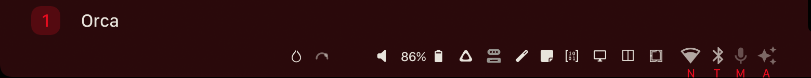
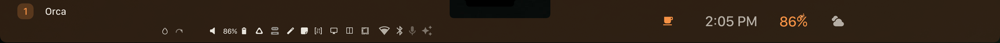

# Top Bar v4: tray out, second level back left (2026-11-26)

Built by Claude Sonnet 5.5 from `docs/omarchy-bar-refined-brief.md` and `docs/omarchy-bar-topbar-v4-brief.md`. The brief was downloaded first. The theme stays **Afterburn Redline**.

**Built:**
- The system tray is **removed** from the bar (no chevron, no drawer).
- The second level is **back in the left island's bottom row**, right-justified at 30px padding, tight as in v3. **Everything fits: 497px in 717px of room.**
- The band under the notch is plain fill again.
- Omapop's icon stays visible.
- The right island, quick tiles and geometry are untouched.

## Audit (v3 as it was)

The band under the notch held:
- the 16 loaded widgets of `inventoryIds` (derived from `shell.json` → `bar.layout`);
- then the four status lights.

The tray was **one entry, `omarchy.tray`** (`bar.layout.right`). At rest it drew only the **drawer chevron "<"**. Its drawer held the three registered `StatusNotifierItem` apps: **Vicinae, Superwhisper, LocalSend**.

## Pulled out: the tray

| Removed | How |
|---|---|
| `omarchy.tray` (chevron + drawer) | Deleted its entry from `shell.json` → `bar.layout.right`. `inventoryIds` comes from that layout, so the bar no longer loads it (`hosted` no longer lists it) |
| Tray icons: Vicinae, Superwhisper, LocalSend | Gone from the bar with the tray. **The apps keep running.** Only their tray icons are no longer shown anywhere |

**What remains reachable without the tray:**
- **Superwhisper:** **kept**. Its own bar widget, `superwhisper.panel`, is a separate entry and stays in the row.
- **Vicinae:** still runs, and its own binds and window are unaffected. Its tray icon was tray-only, and it is the launcher being phased out anyway.
- **LocalSend:** **tray-only on the bar.** Its icon was its only bar presence. The app is still launchable from the app launcher.

The edit is to `shell.json`, so the tray stays out of the stock bar too. Reverting is one entry (it's in the build-start backup).

## Back left: the second level

`statusIsland` returns to the left ear's lower level:
- `y` = 2 + 35, height 35;
- **right-justified at `island.left-padding` (30) from the notch**: its ink ends at **746** (target 747);
- the v3 tightening is kept: `band.widget-spacing` **0** between stock widgets (their slots carry about 5px a side) and `band.spacing` **10** between the groups and lights.

The status IPC's `band` now reports the left island's room (`2 × leftCenter − 2 × 30`).

| | px |
|---|---|
| Room in the left island (777 − 30 − 30) | **717** |
| Bottom row now | **497** (v3 524, minus the tray's 27) |
| **Fit** | **Fits, 220 spare.** Ink spans x 280.5–746 |

## Bottom-row inventory (left → right)

| # | Widget | What it shows at rest | px |
|---|---|---|---|
| 1 | `omarchy.indicators` | Nothing at rest | 0 |
| 2 | `omarchy.system-update` | Nothing (no updates) | 21 |
| 3 | `io.github.smoothpixels.glyph-menu` | Hyprland mark: Omarchy menu | 25 |
| 4 | `io.github.cwilliams5.locus` | Night-light arc | 27 |
| 5 | `omarchy.keyboard-layout` | **Blank** (one layout) | 30 |
| 6 | `omarchy.audio` | Speaker | 27 |
| 7 | `omarchy.power` | "86%" + battery: **duplicates the right ear** | 54 |
| 8 | `superwhisper.panel` | Superwhisper | 27 |
| 9 | `io.github.jondkinney.omapop` | **Omapop's icon** (v3 fix kept) | 27 |
| 10 | `omarchy-fx` | FX pen | 27 |
| 11 | `acooper.scratchpad` | Note | 21 |
| 12 | `io.github.whiskeytangofussell.matrixscreens` | [10/01] | 27 |
| 13 | `omarchy.monitor` | Display | 27 |
| 14 | `io.github.denonmaryland.tricky-tiles` | Split | 27 |
| 15 | `jimmy.menu` | Launcher frame | 27 |
| — | `lock-explorer` | Not loaded (raw `type: qml` entry only the stock bar resolves) | — |
| + | Wi‑Fi, Bluetooth, mic, agents | Status lights (leader N T M A) | — |

## What to trim first (the easy edit, now that it's all visible)

1. **`omarchy.power`**: duplicates the battery % on the right (the widest item, 54).
2. **`omarchy.keyboard-layout`**: blank with one layout (30 of empty slot).
3. **`glyph-menu` + `jimmy.menu`**: both open a menu Super+Space already opens.
4. **`omarchy.indicators` / `omarchy.system-update`**: invisible at rest. Keep them only if you want them to appear when something is up.
5. Then by taste: `matrixscreens`, `omarchy-fx`, `tricky-tiles`, `omarchy.monitor`. These are settings-type widgets you open rarely, and each is reachable from its own panel or menu.

## Verified live

| Check | Result |
|---|---|
| Tray / chevron | Gone (`hosted` has no `omarchy.tray`; no "<" in the bar) |
| Second level | Back in the left island, bottom row, right-justified, tight; **497 / 717** |
| Omapop | Icon visible (Omapop's `BarWidget.qml` fix from v3 still in place) |
| Left island | Top: workspace chip at x 30 + title; bottom ends at 746 (30 from the notch). Two levels, staggered |
| Band under the notch | Plain fill: (1728, 130) = (42, 9, 11) Redline, (46, 31, 19) Afterburn. No elements |
| Notch | Clean cut-out: (0, 1, 0) / (7, 11, 10) |
| Right island | Unchanged (time bbox 174 × 36 at the same y 57; width varies with the time text); quick tiles unchanged |
| Leader Super+D | **N T M A** on the left bottom row's edge under the lights, legible, not clipped; Q C B W unchanged |
| Panels | Audio drops from its bottom-row icon; network from the Wi‑Fi light; **calendar from the right ear** |
| Desktop / geometry | Desktop (88, 0, 0) Redline, (9, 14, 7) Afterburn, untinted; bar 75; **`[0, 75, 0, 0]`**; windows **y 82**; float rule unchanged (314, 286); tint 0.22 |
| Themes | Afterburn verified, **Redline restored** |
| Health | `hyprctl configerrors` empty; no `jimmy.bar` errors |

**Not exercised live:** Super+L / Super+T, a fullscreen toggle, and opening a new floating window. Those code paths are unchanged.

## Build checklist

| Step | Result |
|---|---|
| Build start | `omarchy-kbd-backlight hold`, `omarchy toggle idle stay-awake` |
| Backup | **`~/.local/state/omarchy-launcher-backups/20261126-140431-bar-topbar-v4`**: mode 700, **2,401 files**, live = backup. Excluded (named): `*.bak*`, `__pycache__`, symlinks, runtime state. No runtime state in git |
| Live after vs backup | Exactly `jimmy.bar/Bar.qml`, `shell.toml` (comment), `shell.json` (tray entry removed) |
| Reloads | One `omarchy restart shell`, on its own |
| Build end | `omarchy toggle idle allow-idle`, `omarchy-kbd-backlight release` → **`"enabled":true,"stayAwake":false`** |
| Snapshot | `plugins/jimmy.bar/Bar.qml`, `config/omarchy/shell.{toml,json}`, `config/hypr/border-fx.lua` equal live |

## Files changed

- `~/.config/omarchy/plugins/jimmy.bar/Bar.qml`: the second level is back in the left island's bottom row (right-justified, 30px); `band` status reports the left room; comments updated.
- `~/.config/omarchy/shell.json`: `omarchy.tray` removed from `bar.layout.right`.
- `~/.config/omarchy/shell.toml`: `[band]` comment (values unchanged: 10 / 0).
- Repo snapshot; `docs/omarchy-bar-topbar-v4-brief.md`; this report; `docs/reports/bar-topbar-v4/*.png`.
