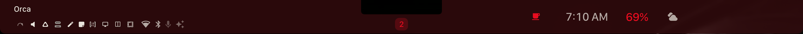
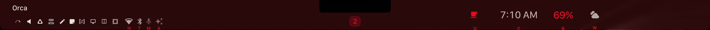
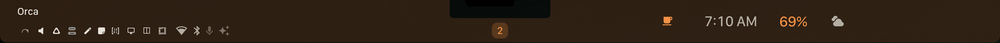

# Top Bar v6: workspaces under the notch (2026-11-27)

Built by Claude Sonnet 5.5 from `docs/omarchy-bar-refined-brief.md` and `docs/omarchy-bar-topbar-v6-brief.md`. The brief was downloaded first. The theme stays **Afterburn Redline**. Testing was kept to the minimum: one restart, one leader capture, one theme check, no loops, no `wtype`, no app launches.

**Built:**
- The workspaces moved from the left island into the **band below the notch**, centred.
- The left island is now **title on top, icon row below, both left-justified** at 30px.
- The icon row's content and order are unchanged.
- The right island is untouched, and `jimmy.menu`'s layout entry was not touched.

## What moved (`jimmy.bar/Bar.qml`)

| | From (v5) | To (v6) |
|---|---|---|
| **Workspaces** (`workspaceRow`: occupied + active chips, accent fill on the active one, click → `hl.dsp.focus({ workspace })`) | First item of `leftIsland`'s top row, before the title | A new `workspaceIsland`, centred on the screen (`x = (width − w)/2`), `y` from the notch's bottom (32) to the bar's (75). The chips' code is moved unchanged |
| **Title** | Top row, after the workspaces, width capped by the island minus the workspaces | Top row alone, left-justified at x 30, elides at the island width |
| **Icon row** (`statusIsland`) | Bottom row, right-justified 30px from the notch | Bottom row, **left-justified at x 30** (`x: root.leftPadding`) |

Nothing else changed: no tokens, `shell.json` untouched, one QML restart. The workspace data source and the leader binds (`bindings.lua`, Super+D then 1–9) are unchanged, so the leader still switches workspaces. The chips have no on-screen leader letters, the same as before.

## Measured live (logical px)

| Element | Ink x | Ink y centre |
|---|---|---|
| Title ("Orca") | 31.0 – 65.5 | **20.25** (target about 20) |
| Icon row (locus … agents) | 37.5 – 395.5 (slot starts at 30; the first glyph's own padding) | **54.25** (target about 54) |
| Workspace chip (one: "2") | chip **850 – 878** (28 wide), y 40–68; digit 860–868 | **54.0** |
| Notch | 777 – 951 (centre 864) | — |

**Width vs the 174px notch:** each chip is 28 wide with a 2px gap, so the row is `30n − 2` px:

| Occupied workspaces | Row width | Fits under the notch |
|---|---|---|
| 1–5 | 28 – 148 | Inside 174 |
| 6 | 178 | 2px past each side |
| 9 (max shown) | 268 | 47px past each side, still inside the band |

Right now only workspace 2 is occupied, so the row is 28 wide, centred at 864. **Chips were not shrunk:** beyond 5 occupied workspaces they spread either side, as the brief allows, for you to judge by eye.

The icon row is 367 wide in 717 of room (unchanged).

## Verified (once each)

| Check | Result |
|---|---|
| Layout | Title top-left, icon row bottom-left, workspace centred under the notch (screenshot above) |
| Leader Super+D (one capture) | **N T M A** under the status lights (now at x about 300–395); Q C B W on the right; submap reset afterwards |
| Bar / reserves | 75px; **`[0, 75, 0, 0]`**; `hyprctl configerrors` empty; no `jimmy.bar` QML errors |
| Fill | Redline bar (42, 9, 11), notch (0, 1, 0). Afterburn bar (46, 31, 19), notch (7, 11, 10), active chip warm accent tint (90, 57, 30). **Redline restored** |
| Binds unchanged | Super+Space → omacast launcher; Alt+Space → Vicinae; Super+Ctrl+E → Emojis; Super+Ctrl+V → Clipboard manager |
| Right island | Unchanged |

**Not tested (needs your hand, per the minimum-testing rule):** clicking a workspace chip under the notch. I have no pointer tool, and switching would move your desktop. The click handler is the same code moved, but it is worth one click. The desktop sample point is now covered by a window on workspace 2, so the "desktop untinted" pixel is not re-measured here; the bar fill code is unchanged.

## Later list (not built in this stage)

1. **Emoji picker: default to last item chosen.** When the emoji picker comes up, it should default to the last item chosen. (James, 2026-11-27: "when that emoji picker comes up, I need it to default to the last item chosen.")
2. **Emoji picker keybind: check what we have.** James asked: "didn't we have a keybind for that emoji picker?"

**Answer to item 2 (checked live, nothing changed):**
- **Our `jimmy.emojis` picker is Super+Ctrl+E**, and **`jimmy.clipboard` is Super+Ctrl+V** (`hyprctl binds`: "Emojis", "Clipboard manager").
- **Oma-cast's emoji** is its built-in "Search Emoji & Symbols" command, a different picker inside the oma-cast launcher. It opens from Super+Space (oma-cast) by typing "emoji". It has **no hotkey of its own**: its optional `omacast:emoji` bind was not set in the trial.
- **"Default to last item"** would need doing separately for each:
  - `jimmy.emojis` is our clone, so we'd change it ourselves;
  - oma-cast's picker already shows a Recently Used section, but whether its selection starts on the last pick needs checking.

  The emoji you reach with Super+Ctrl+E is `jimmy.emojis`.

## Build checklist

| Step | Result |
|---|---|
| Build start | `omarchy-kbd-backlight hold`, `omarchy toggle idle stay-awake` |
| Backup | **`~/.local/state/omarchy-launcher-backups/20261127-070933-bar-topbar-v6`**: mode 700, **2,599 files** (now includes the oma-cast plugin dir, minus its build target), live = backup. Excluded (named): `*.bak*`, `__pycache__`, symlinks, runtime state |
| Live after vs backup | Only `jimmy.bar/Bar.qml` |
| Reloads | One `omarchy restart shell`, on its own |
| Build end | `omarchy toggle idle allow-idle`, `omarchy-kbd-backlight release` → **`"enabled":true,"stayAwake":false`** |
| Snapshot | `plugins/jimmy.bar/Bar.qml` equals live |
