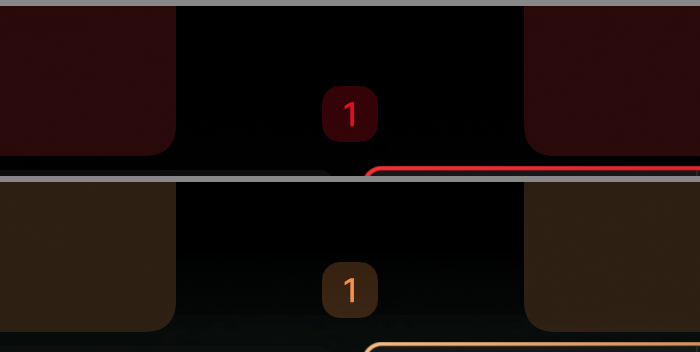

# Top Bar v7: three islands, black centre fading to clear (2026-11-27)

Built by Claude Sonnet 5.5 from `docs/omarchy-bar-refined-brief.md` and `docs/omarchy-bar-topbar-v7-brief.md`. The brief was downloaded first. The theme stays **Afterburn Redline**. Testing was kept to the minimum: one restart, one capture per theme, one leader capture.

**Built:** a look change only; no element moved.
- The bar now reads as **three islands**: the left and right ears in the tinted glass, with the inner bottom corners curving back toward their own sides, and a **black centre** under the notch.
- The centre is solid black from the top of the screen down to the notch's bottom, so **the notch disappears**, then it **fades to clear** by the bar's bottom.
- Workspaces stay in the centre. Everything else is unchanged.

**Prerequisite:** Top Bar v6 was **already live** (`215570e`: workspaces under the notch, left island both levels left-justified). This look sits on it unchanged.

## How it's drawn (`jimmy.bar/Bar.qml`)

**One surface, three shapes:** the bar's existing `Canvas` (`id: fill`, under all the elements) now paints them. It replaces v1–v6's single tinted rectangle with the notch cut out.

| Shape | Geometry (logical px) | Fill |
|---|---|---|
| **Left ear** | x 0 → **777** (the notch's left edge), y 0 → 75. Outer bottom corner `island.radius` 13; **inner bottom corner `bar.inner-radius` 16**, curving down and back to the left | Theme tint: `Qt.tint(background, accent @ bar.tint 0.22)` at glass alpha 0.70, unchanged and still translucent |
| **Right ear** | x **951** → 1728, mirrored; inner bottom corner 16, curving to the right | Same tint |
| **Centre** | x 777 → 951 (**174 wide**, the notch's width), y 0 → 75 | A vertical **gradient**: black alpha 1 at y 0, **black alpha 1 at y 32** (the notch's bottom), **alpha 0 at y 75**. The only hardcoded colour is black, as the brief allows |

- The **curved inner edges** live in the Canvas's `ear()` helper: each ear's inner edge runs straight down beside the centre, then a quadratic curve of radius 16 turns it back toward its own side at the bottom.
- **Between each ear and the centre:** at the top they meet (tint beside black). Below, the 16px curve opens a scooped **valley** where the wallpaper shows through the fading centre.
- The **notch is no longer cut out.** The centre's black covers it from the top edge, so the camera housing blends in.
- Islands: left ear **777** wide, centre **174**, right ear **777**. Horizontal gaps: 0 at the top, opening to the 16px curve at the bottom. Curve radius **16** (the windows' rounding).
- Tokens: `bar.inner-radius = 16` added. The now-unused `notch.radius` (the v1 cut-out's corner) was removed. `bar.tint` and `bar.height` are unchanged.

## Measured live

**Centre fade** (centre column at x 830, logical y):

| y | 10 | 32 | 40 | 48 | 56 | 64 | 70 | 74 |
|---|---|---|---|---|---|---|---|---|
| **Afterburn** | (0,0,0) | (0,0,0) | (1,2,2) | (2,3,3) | (3,5,4) | (4,7,6) | (7,11,10) | **(8,12,11)**, the wallpaper (7,11,10) |
| **Redline** | (0,0,0) | (0,0,0) | (0,0,0) | (0,0,0) | (0,1,0) | (0,1,0) | (0,1,0) | (0,1,0) |

The fade is exact on both. Redline's wallpaper is itself near-black right behind the centre, so the fade has nothing to reveal there, and the centre reads as solid black down to the bar's edge. Over a lighter wallpaper area it would show.

| Check | Redline | Afterburn |
|---|---|---|
| Ears tinted, translucent | (42, 9, 11) | (46, 31, 19) |
| Notch invisible | (1728, 30) = **(0, 0, 0)**, part of the black | **(0, 0, 0)** |
| Curved valley (774, 73) | Wallpaper (0, 1, 0) | Wallpaper (7, 11, 10) |
| Workspace chip "1" | Digit **(232, 12, 31)** on chip (51, 4, 7), over black: **legible** | Digit **(245, 145, 69)** on chip (56, 35, 17): **legible** |

**Redline restored** afterwards.

## Verified (once each)

| Check | Result |
|---|---|
| Layout unchanged | Title and icon row left (x 30); time / battery / weather right; workspace chip centred under the notch |
| Leader Super+D (one capture) | **N T M A** under the status lights; **Q C B W** on the right; submap reset |
| Bar / reserves | 75px; **`[0, 75, 0, 0]`**; `hyprctl configerrors` empty; no `jimmy.bar` QML errors |
| Unchanged | Float default and inheritance, Super+L / Super+T, Super+Space (oma-cast), Alt+Space (Vicinae), pickers, bottom row (incl. `jimmy.menu`), no tray |

**For you to verify by hand:** **click a workspace chip** under the notch to switch. I have no pointer tool, and the minimum-testing rule rules out simulating it. The chip's click handler is unchanged from v6; leader 1–9 switches workspaces too.

## Build checklist

| Step | Result |
|---|---|
| Build start | `omarchy-kbd-backlight hold`, `omarchy toggle idle stay-awake` |
| Backup | **`~/.local/state/omarchy-launcher-backups/20261127-162355-bar-topbar-v7`**: mode 700, 2,596 files, live = backup |
| Live after vs backup | Only `jimmy.bar/Bar.qml` and `shell.toml` |
| Reloads | One `omarchy restart shell`, on its own |
| Build end | `omarchy toggle idle allow-idle`, `omarchy-kbd-backlight release` → **`"enabled":true,"stayAwake":false`** |
| Snapshot | `plugins/jimmy.bar/Bar.qml`, `config/omarchy/shell.toml` equal live |

## For your eye

- **The curve's shape:** I read "stops at the cut-out, then curves down toward its own side" as each ear running straight down beside the notch, then a 16px rounded corner turning back at the bottom. If you meant the curve to start right at the notch's bottom (y 32) and sweep down over the full 43px, that's a small change to `ear()`.
- **Fade length:** black to y 32, clear at 75. The fade start and end are one line each if you want them changed.
