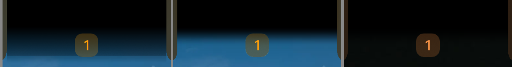

# Centre fade fix: smooth, and clear by y 55 (2026-11-27)

Built by Claude Sonnet 5.5 from `docs/omarchy-bar-refined-brief.md` and `docs/omarchy-centre-fade-fix-brief.md`. The brief was downloaded first.

**Fixed:**
- The centre fade is **smooth**, with no seam and no kink.
- It reaches **clear by y 55**, so the bar's bottom 20px is plain wallpaper.
- The notch stays at its real width (190, x 769–959, already live from the notch fix, `c0ba3c0`).
- The ears, curve, elements, bar height and reserves are unchanged.

**Theme:** the live theme at build start was **Starship** (you switched it since the notch fix), so I verified on Starship and Afterburn default and **put Starship back**.

## What was wrong: the hard line was a blur seam, not gradient banding

**How it was drawn (v7):** one `Canvas` on the `jimmy-bar` layer painted the ears and the centre. The centre was a linear gradient with three stops: black at 0, black at y 32, alpha 0 at y 75.

**What you saw:** the column at x 790 on Starship, before:

```
y   60          62          64          66          68          70
    16,50,72    16,52,77    18,56,83    20,60,89    30,87,125   36,92,134
```

There is a jump of about +37 in one 2px step at **y 66–68**. A linear gradient can't do that. It happens exactly where the fade's alpha crosses **0.2** (75 − 0.2 × 43 ≈ 66.4).

**Cause:** `~/.config/hypr/menu-glass.lua` gives the `jimmy-bar` layer `blur = true, ignore_alpha = 0.2`, which is what gives the ears their glass. Hyprland blurs the wallpaper behind every pixel of that layer that is **at least 20% opaque** and leaves the rest sharp. So the fade had a hard seam where blurred wallpaper (above) met sharp wallpaper (below), which reads as a band.

I confirmed it: my first fix (a smooth curve on the same layer) just moved the seam to where the new curve crossed 0.2 (y 48–50). Two small things added to the hard look: the linear ramp's sharp kink at y 32, and its abrupt stop at the bar's bottom edge.

## What changed (`jimmy.bar/Bar.qml`, `shell.toml`)

1. **The centre is now its own surface**, `jimmy-bar-centre`: a click-through layer, exactly the notch's size (190 × 75 at x 769, live), on the Bottom layer, under the bar's elements. **No blur rule matches it**, so nothing cuts a seam across the fade. The ears' Canvas paints only the two ears and keeps its glass blur. The workspace chips still draw on the bar above it. It hides with the bar under fullscreen.
2. **The gradient:**

   | | Old | New |
   |---|---|---|
   | Solid black | y 0 → 32 | y 0 → 32 (unchanged) |
   | Fade | linear, alpha 1 → 0 over y 32 → **75** | **smoothstep** (`1 − t²(3 − 2t)`) sampled at **17 stops** over y 32 → **55** |
   | After the fade | — | alpha 0 from y 55 to 75: wallpaper |

   Smoothstep eases in and out, so there's no visible edge where the fade starts or ends. 17 stops keep the straight segments between stops invisible.
3. **Token** `bar.fade-end = 55` (`shell.toml [bar]`). The fade start is still the notch's bottom (`notch.height` 32).

## Pixel samples down the centre column (x 790)

**Starship, after:**

```
y   32     36      40       44       48        52        56        60
    0,0,1  2,8,12  7,27,39  13,50,74 19,74,110 27,91,134 31,98,141 34,100,143
```

Monotonic, even steps (about +10–12 in green every 2px), **no jump**, and at the wallpaper's own value from about y 56.

**Afterburn default, after:**

```
y   32     38     44     50      56        62+
    0,0,0  1,2,2  4,6,5  6,10,9  10,12,11  7,11,10 (wallpaper)
```

Smooth too. Afterburn's wallpaper is dark, so the ramp is short in absolute terms.

**Notch edges unchanged:** at y 16, x 768 is ear, **769 and 958 are (0, 0, 0)**, and 959 is ear.



## Workspace legibility

The chip now sits mostly over wallpaper (the fade clears at 55; the chip spans y 40–68):

| Theme | Chip background | Digit | Verdict |
|---|---|---|---|
| Starship | (68, 74, 59) → (74, 94, 89) | **(255, 159, 10)** accent | **Legible**: bright orange on a dark grey-green chip |
| Afterburn | (57, 37, 19) → (59, 39, 22) | **(245, 145, 69)** accent | **Legible** |

**Nothing was added** to the chip (no new background or outline). It is the same accent-tinted chip as before; only the black behind it ends higher.

## Verified (once each)

| Check | Result |
|---|---|
| Layers | `jimmy-bar-centre` 769, 0, 190 × 75 (Bottom); `jimmy-bar` 1728 × 87 (Top) |
| Workspaces | Chip centred on 864 under the notch |
| Leader Super+D | Letters shown and the submap reset |
| Bar / reserves | 75px; **`[0, 75, 0, 0]`**; `hyprctl configerrors` empty; no QML errors |
| Theme | Starship → Afterburn → **Starship restored** |

**For you to check by eye:**
- **Is the fade smooth now, and does it end high enough?** It's one token: `bar.fade-end` (55; try 50 for shorter or 62 for longer).
- **Click the chip once to switch**, since I have no pointer tool. Its click code is unchanged.

## Build checklist

| Step | Result |
|---|---|
| Build start | `omarchy-kbd-backlight hold`, `omarchy toggle idle stay-awake` |
| Backup | **`~/.local/state/omarchy-launcher-backups/20261127-163338-centre-fade-fix`**: mode 700, 2,596 files, live = backup |
| Live after vs backup | Only `jimmy.bar/Bar.qml` and `shell.toml` |
| Reloads | Two `omarchy restart shell`, each on its own: the smooth curve, then the separate surface once the blur seam was found |
| Build end | `omarchy toggle idle allow-idle`, `omarchy-kbd-backlight release` → **`"enabled":true,"stayAwake":false`** |
| Snapshot | `plugins/jimmy.bar/Bar.qml`, `config/omarchy/shell.toml` equal live |
