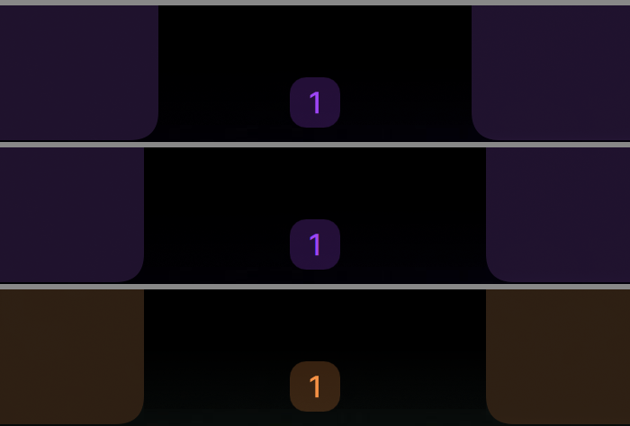

# Notch measurement fix: 190px wide, x 769–959 (2026-11-27)

Built by Claude Sonnet 5.5 from `docs/omarchy-bar-refined-brief.md` and `docs/omarchy-notch-measure-fix-brief.md`. The brief was downloaded first.

**Built:**
- `notch.width` is **190** (was the provisional 174).
- The black centre now covers **x 769–959**, and the ears stop at the real notch edges: left ear 0 → 769, right ear 959 → 1728, still with the 16px inner curves.
- The fade (black to y 32, clear at 75), the curve, the bar height and the reserves are unchanged.
- It hot-reloaded: **no shell restart**.

**Theme:** at build start the live theme was **Afterburn Phantom** (you switched it since v7), not Redline. I verified on Phantom and on Afterburn default, then **put Phantom back** (`omarchy theme current` = Afterburn Phantom).

## Audit: every place the old width lived

Everything derives from the one token. No 777 / 951 was hardcoded anywhere; those came from `(1728 − 174) / 2`.

| Place | Old | New |
|---|---|---|
| `~/.config/omarchy/shell.toml` `[notch] width` | 174 (comment: "348 physical columns … provisional") | **190**, with a comment recording your ruler reading (95 each side, x 769–959) |
| `jimmy.bar/Bar.qml` `notchWidth` fallback | `num("notch.width", 174)` | 190. This drives the Canvas: ears and centre (`x0 = (w − notchW)/2`) |
| `jimmy.shared/BarGeometry.js` `ears()` fallback | 174 | 190. This drives the ear centres and island room: right-island centre, left island `maxWidth`, toasts via `BarLayout` |
| `jimmy.notch-ruler/Ruler.qml` fallback | 174 | 190 (the calibration overlay's solid lines now show 190) |

**Workspace centring** was already on the screen centre (`x = (width − w)/2` → **864**), so it needed no change.

## Old vs new geometry (logical px)

| | v7 (174) | Now (190) |
|---|---|---|
| Centre (black → fade) | 777 – 951 | **769 – 959** |
| Left ear | 0 – 777 | **0 – 769** |
| Right ear | 951 – 1728 | **959 – 1728** |
| Ear centres (`BarGeometry`) | 388.5 / 1339.5 | **384.5 / 1343.5** |

## Pixel checks at the edges (the v7 claim, re-checked properly)

**Before the fix, Phantom, y 16:** ear tint (31, 18, 45) ran all the way to **x 776**, and again from **951** to 959. That is 8px of tinted ear on each side **inside** the real notch (769–959): the part you could see. Black covered only 777–950. **The v7 report's "notch invisible" was measured at the notch's centre (x 864), not at its edges. That was the wrong check.**

**After, at y 16 and at the top row (y 0):**

| x | 768 | **769** | 777 | 951 | **958** | 959 |
|---|---|---|---|---|---|---|
| **Phantom** | ear (31, 18, 45) | **(0, 0, 0)** | (0, 0, 0) | (0, 0, 0) | **(0, 0, 0)** | ear (31, 18, 46) |
| **Afterburn** | ear (46, 31, 19) | **(0, 0, 0)** | — | — | **(0, 0, 0)** | ear (46, 31, 19) |

Black now fills exactly **769–958** (190 px) at both rows, on both themes. The ears start at the first pixel outside the measured notch. The fade is unchanged (centre at y 74 = (2, 1, 6), the wallpaper's value), and the valleys at y 73 show wallpaper either side.

## Elements

- **Workspace chip:** centred on **864** before and after (28 px chip, so 850–878); unmoved.
- **Right island:** its centre is derived from the ear width, so it moved **2px right** (ink centre 1304.25 → 1306.25), as the brief's "everything derived from the old width" implies. Nothing else moved.
- **Unchanged:** left island (x 30), bar 75px, reserves **`[0, 75, 0, 0]`**, `hyprctl configerrors` empty, no QML errors, float default and inheritance, binds, pickers.

## What to check by eye

**Can you still see where the notch sits?** The pixels now say black runs exactly to your 95-each-side marks. If an edge still shows, the measurement and the black disagree by a pixel or two. It's one token: `notch.width` (192 gives 768–960). The notch ruler's solid lines now draw at 190, so you can re-check against them.

## Build checklist

| Step | Result |
|---|---|
| Build start | `omarchy-kbd-backlight hold`, `omarchy toggle idle stay-awake` |
| Backup | **`~/.local/state/omarchy-launcher-backups/20261127-162934-notch-measure-fix`**: mode 700, 2,596 files, live = backup |
| Live after vs backup | Exactly `shell.toml`, `jimmy.bar/Bar.qml`, `jimmy.shared/BarGeometry.js`, `jimmy.notch-ruler/Ruler.qml` |
| Reloads | None: the token hot-reloaded. No restart, no `hyprctl reload` |
| Testing | One capture before, one after, one on Afterburn; no loops |
| Build end | `omarchy toggle idle allow-idle`, `omarchy-kbd-backlight release` → **`"enabled":true,"stayAwake":false`** |
| Snapshot | All four files equal live |
