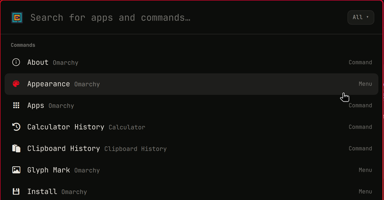
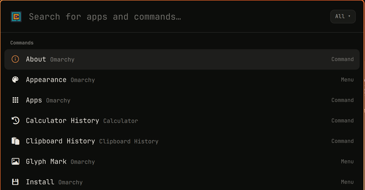

# Oma-cast trial: Super+Space → omacast (2026-11-27)

Built by Claude Sonnet 5.5 from `docs/omarchy-bar-refined-brief.md` and `docs/omarchy-omacast-trial-brief.md`. The brief was downloaded first.

**Done:**
- oma-cast is installed and enabled, and **Super+Space opens it**.
- **Vicinae is untouched** (Alt+Space).
- `jimmy.menu` stays enabled as the fallback.
- `omacast doctor` is all green.
- In the focus tests the launcher **never came up refusing keys**; caveats below.
- Undo is one command.

The focus testing was cut short at your request ("finish up"); the results below are what had run by then.

## What was installed

| Piece | Where |
|---|---|
| Plugin `typecraft.omacast` 0.1.0, commit **`283fee5`** (reviewed before install: CLI, setup, clipboard watcher, network calls) | `~/.config/omarchy/plugins/typecraft.omacast` via `omarchy plugin add … --enable --yes`. `--yes` acknowledges the shell's "unsandboxed code" prompt |
| Enable entry | `shell.json` → `plugins[]`: `{ "id": "typecraft.omacast" }` |
| Search helper | `omacast install` built `bin/omacast-search` with cargo (build cache in `~/.cache/omacast/search-target`) |
| CLI | `~/.local/bin/omacast` → the plugin's `bin/omacast` |
| Config (written **before** install) | `~/.config/omacast/config.json` (mode 600, dir 700): `{ "clipboardHistory": false }`, so oma-cast never records the clipboard during the trial. Verified: its clipboard DB has **0 entries** and no files |
| Data dirs it created | `~/.local/share/omacast` (db: calculator, clipboard (empty), emoji, frecency, settings), `~/.cache/omacast`, all owner-only |

## Binds changed

`omacast setup hyprland` was run as the brief asked. **It refused, changing nothing**: its conflict check found Alt+Space already bound (Vicinae in `bindings.lua:29`, and stock dictation in `default/hypr/bindings/dictation.lua:15`). It only ever binds Alt+Space, so I wrote its file by hand with Super+Space instead. There was no existing `omacast.lua` to overwrite.

| File | Change |
|---|---|
| **`~/.config/hypr/omacast.lua`** (new) | Setup's own content, except the key: `hl.unbind("SUPER + SPACE")` then `o.bind("SUPER + SPACE", "omacast launcher", hl.dsp.global("omacast:toggle"), { submap_universal = true })`. Also its `omacast` submap (so Super+J/K reach the launcher while it's open) and its blur layer rule |
| **`~/.config/hypr/hyprland.lua`** (last 2 lines) | `-- omacast launcher bindings` / `require("hypr.omacast")`: the exact lines `omacast uninstall` looks for |
| Stock files | **Untouched.** `/usr/share/omarchy/default/hypr/bindings/utilities.lua:1` still declares Super+Space → Omarchy menu; our file unbinds it after load |

Live (`hyprctl binds`): **Super+Space → "omacast launcher"**, Alt+Space → **"Vicinae"**. `hyprctl configerrors` is empty.

## Vicinae, `jimmy.menu`, pickers

- **Vicinae:** unchanged. Still Alt+Space (`bindings.lua:28–29`), still installed. Its keybind workflow is untouched.
- **`jimmy.menu`:** **still enabled** (`listPlugins: enabled True`). It stays loaded through its `bar.layout.tray` entry, which was not touched, so **its launcher icon stays in the bottom row**. Clicking that icon opens it, as does `omarchy-menu toggle root`. **No key opens it now:** Super+Space was its only key.
- **Emoji and clipboard pickers:** unchanged. Super+Ctrl+E → Emojis and Super+Ctrl+V → Clipboard manager are still `jimmy.emojis` / `jimmy.clipboard`. oma-cast's own hotkeys were **not** bound. **What oma-cast would replace:**
  - its Clipboard History (searchable, pins, a week's retention, skips password managers) would replace `jimmy.clipboard`;
  - its Emoji & Symbols (an 8-column grid with Pinned and Recently Used) would replace `jimmy.emojis`.

  Recording is off for the trial.

## `omacast doctor`

```
ok  omarchy-shell is installed / running
ok  socat is installed (fast shell IPC)
ok  Hyprland socket is reachable
ok  plugin is installed in ~/.config/omarchy/plugins/typecraft.omacast
ok  plugin is enabled / answers IPC
ok  backend answers system.healthPing
ok  no QML errors in the shell log
ok  flea-search helper is built
ok  hotkey file ~/.config/hypr/omacast.lua
```

## Focus-bug test (the reason for the trial)

**Method:** I can't press your keys, so I drove the same path Super+Space takes: `hyprctl dispatch hl.dsp.global("omacast:toggle")`, the dispatcher the bind uses. Each round focused a different app first, then opened the launcher, waited a set delay, typed a word with `wtype` (a virtual keyboard into whatever has focus), checked the result, and closed.

| Test | Result |
|---|---|
| **Esc + Esc closes it** (proves keys reach it) | **40 / 40** rounds, opened from a terminal and from an empty workspace at 0.05–0.2s delays. **It never came up refusing keys** |
| Typed word lands in the search field | **58 / 66** at 0.05–0.4s after open. The 8 misses all reached the launcher; the word ran into the previous round's text (seen in failure captures: the field held "qzx12qzx1qzx2qzx3"). That was my test closing it with `hide` rather than Esc, not lost keystrokes. A later run with OCR on the wrong region reads as 0 and is discarded |
| Typing at **0s** (same instant as the open dispatch) | **0 / 6**: the first keystrokes went to the previously focused app. Needs your judgement by hand: a real keypress comes after the key-down that opens it, so it is not this case, but very fast typists might feel it |
| Search filters | Yes ("nimbus" → Nimbus Mono PS font + web fallbacks; "firefox" filtered) |
| Esc closes | Yes (twice from a search: the first clears the query, the second closes), and the submap returns to `default` |
| Theme follows | Yes, live: red border/accent on **Afterburn Redline**, orange on **Afterburn** default; Redline restored |
| Enter launches / focuses, Ctrl+K | **Not tested.** I didn't want to launch apps on your desktop unattended, and the run was stopped. Ctrl+K's Actions hint shows in the footer |




**For you to check by hand:**
1. Press Super+Space many times from different apps, typing straight away.
2. Press Enter on an app (it launches) and on an open one (it focuses).
3. Try Ctrl+K.

## Unchanged

Bar 75px, reserves **`[0, 75, 0, 0]`**, the left and right islands, float default, Super+L / Super+T, leader keys, Vicinae, `jimmy.menu`, and the emoji / clipboard pickers.

## Undo in one step

```sh
omacast uninstall   # removes the hotkey (omacast.lua + its require in hyprland.lua, after asking),
                    # then runs: omarchy plugin remove typecraft.omacast (plugin, CLI link, enable entry)
```

Then `hyprctl reload`. Super+Space falls back to the stock bind → `jimmy.menu`. Optional: `rm -r ~/.config/omacast ~/.local/share/omacast ~/.cache/omacast` (no clipboard data inside). Everything is also in the build-start backup.

## Build checklist

| Step | Result |
|---|---|
| Build start | `omarchy-kbd-backlight hold` (saved 25), `omarchy toggle idle stay-awake` |
| Backup | **`~/.local/state/omarchy-launcher-backups/20261127-065513-omacast-trial`**: mode 700, 2,435 files, live = backup. Excluded (named): `*.bak*`, `__pycache__`, symlinks, runtime state |
| Live after vs backup (backup's scope) | Exactly `hypr/hyprland.lua` (require) and `shell.json` (enable entry). New outside it: `hypr/omacast.lua`, the plugin dir, `~/.local/bin/omacast` link, the omacast dirs |
| Cleanup | The test terminal is closed; the launcher is hidden; submap `default`; theme Redline |
| Build end | `omarchy toggle idle allow-idle`, `omarchy-kbd-backlight release` (level 25, auto) → **`"enabled":true,"stayAwake":false`** |
| Snapshot | `config/hypr/hyprland.lua`, `config/hypr/omacast.lua` (new), `config/omarchy/shell.json` equal live |
